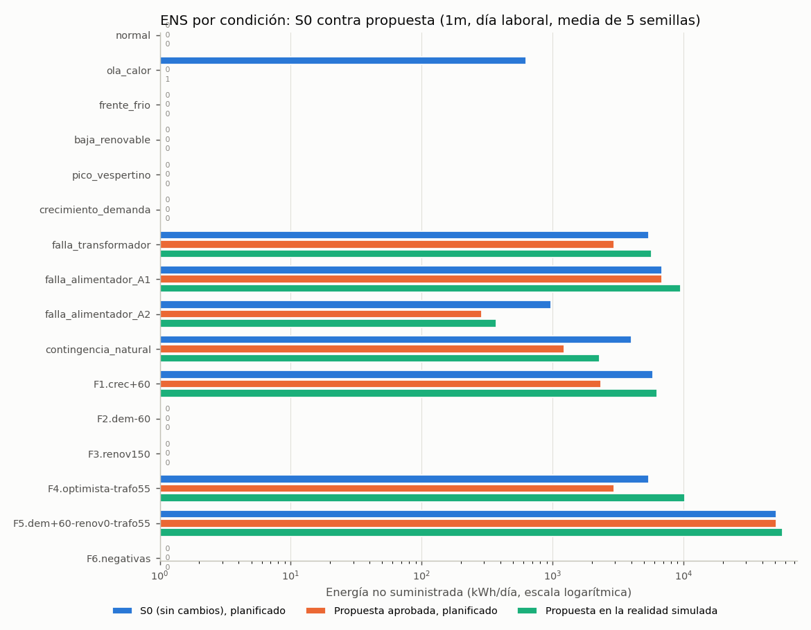
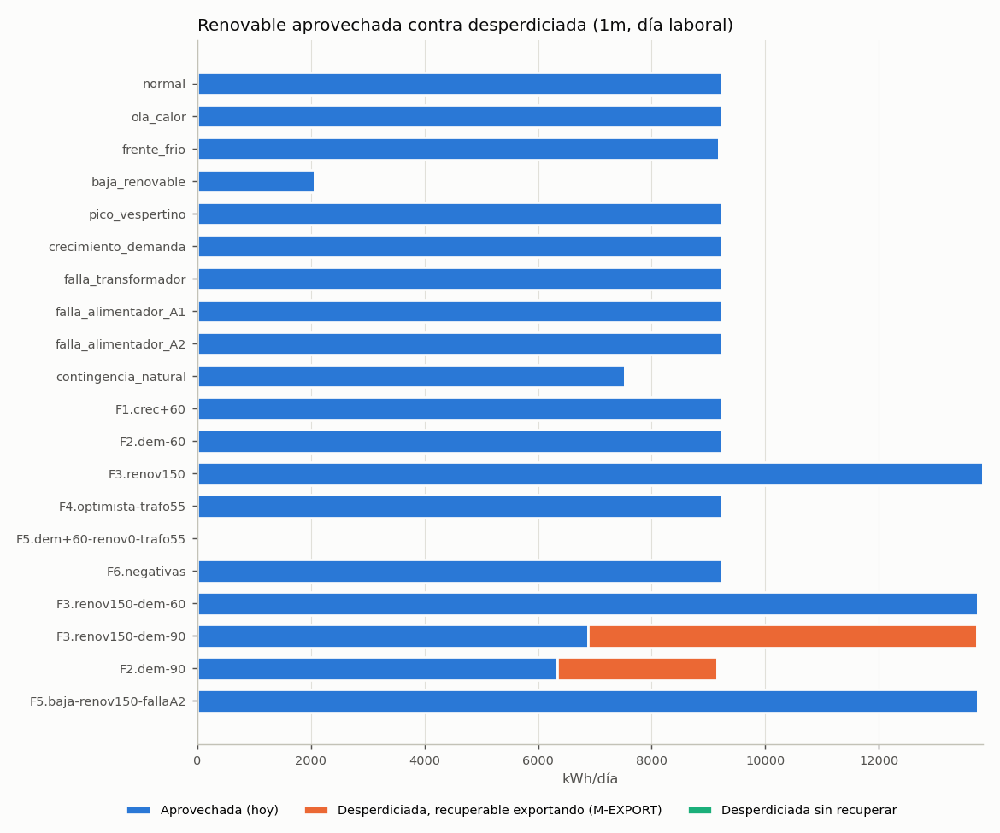
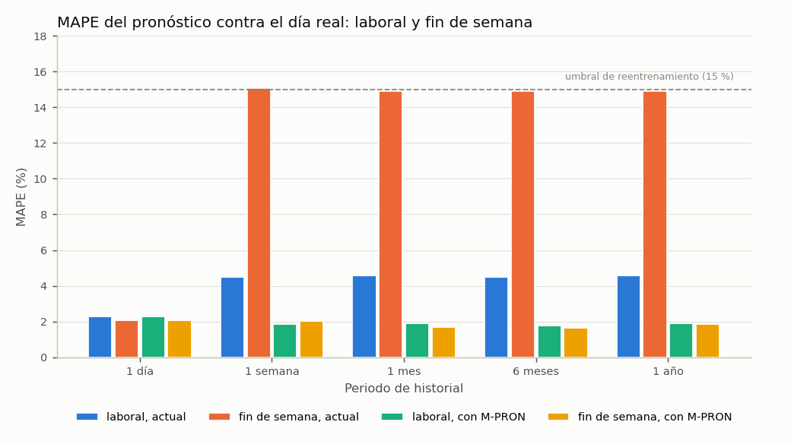
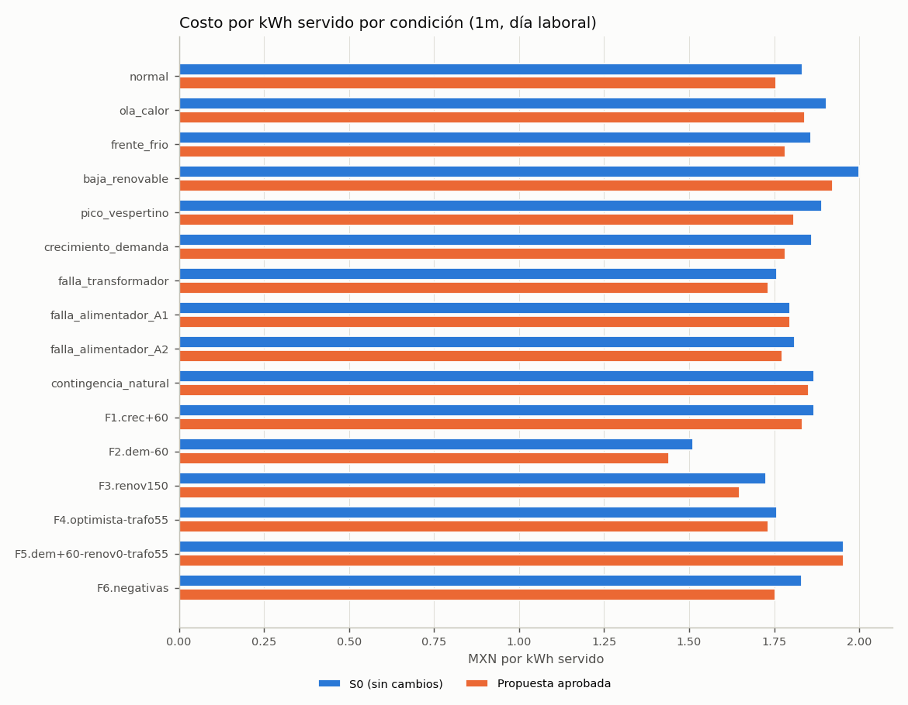
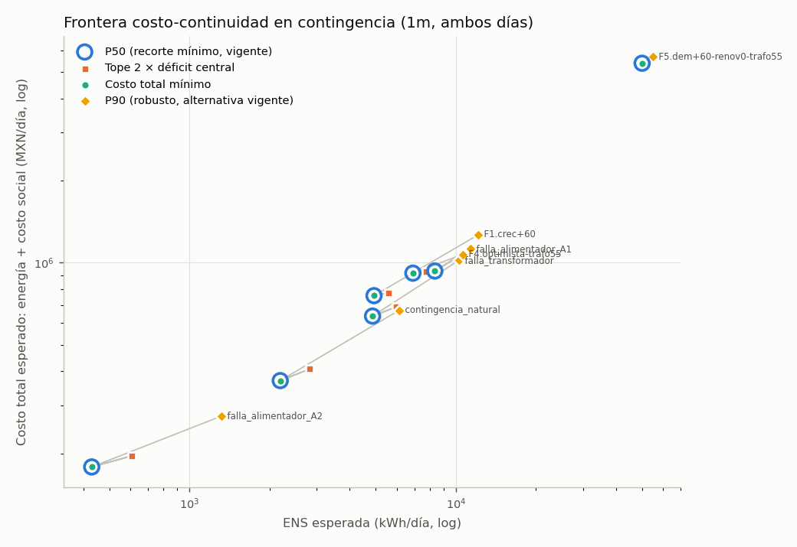
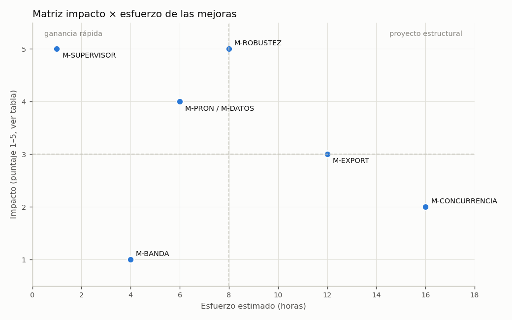

# Evaluación de resultados de ElectriAgent: continuidad, eficiencia y costo

Campaña completa generada por `python evaluar.py` el 2026-11-23 sobre la rama `evaluacion-resultados` (base `main`). Regla: **evaluar, no corregir**: no se modificó la lógica de los agentes, la distribución, la API, la web ni la app. Las mejoras son escenarios hipotéticos que viven solo en `evaluar.py`.

8,100 corridas del motor (1,600 de línea base con el perfil «aprueba»), 2,175 evaluaciones posteriores (exportación y robustez) y una ráfaga de 16 pedidos a la API. Campaña 132 s, total 140 s. Máquina: Windows-11-10.0.26200-SP0, 12 núcleos lógicos, Python 3.13.14, numpy 2.2.6.

Consistencia (criterio 2): en las 7,850 corridas con plan, ENS = recorte + no servido de la Distribucion (±0.1 kWh), Σ ENS por carga = total y costo recalculado desde las series = Σ Distribucion.costo: **0 discrepancias**.

```powershell
python evaluar.py                 # campaña completa y este informe (< 15 min)
python evaluar.py --rapido        # solo 1m (< 2 min), en docs/evaluacion/rapido/
python evaluar.py --corrida CAT.falla_transformador --periodo 1m --semilla 7 --dia laboral --perfil aprueba
python evaluar.py --supuestos mis_supuestos.json   # otros CENS, precios, días o semillas
python pruebas_evaluacion.py      # pruebas de los indicadores (casos calculados a mano)
```

## 1. Dictamen

ElectriAgent **cumple en el plan, pero su pronóstico lo deja corto en la realidad**. Con sus propios datos, en las condiciones del catálogo con déficit la propuesta aprobada reduce la ENS planificada un 38.5 % frente a operar sin cambios (de 3,422 a 2,106 kWh/día), nunca recorta al hospital (0 de 800 propuestas con ENS crítica) y baja el costo total (energía + costo social) un 46.6 %. En costo, los días sin déficit ahorra **4.3 % (5,091 MXN/día)**, todo por desplazamiento tarifario. El punto débil es la **eficiencia del pronóstico**, que ignora el tipo de día: **MAPE real de 15.0 % en fin de semana** contra 4.5 % entre semana, con un sesgo de -4.5 % los días laborales que el MAPE no delata. Ese sesgo se convierte en un problema de **continuidad**: cuando el plan se aplica al día real, entre semana quedan **1,684 kWh/día de ENS no prevista y sin aviso** (B1) y en fin de semana se recortan 2,387 kWh/día de más (A10). Además, una falla en B, G o H (A1) o un medidor vacío (A2) dejan al operador sin plan. Prioridad: corregir A1 y los datos (horas) y cambiar el pronosticador (M-PRON), que por sí solo recupera 88,543 MXN/día de costo total en los días con déficit.

| Eje | Cifra clave | Lectura |
|---|---|---|
| Continuidad | ENS no prevista de 1,684 kWh/día con el plan aprobado en las contingencias del catálogo en día laboral | regular: el plan protege al hospital pero subestima la demanda |
| Eficiencia | MAPE real 15.0 % en fin de semana contra 4.5 % entre semana, con sesgo -4.5 % en día laboral | deficiente en el pronóstico; buena en uso de renovables |
| Costo | ahorro de 4.3 % (5,091 MXN/día) sin déficit; costo total 46.6 % menor que S0 en el catálogo con déficit (planificado) | buena: ahorro tarifario estable |

## 2. Supuestos

Valores **ilustrativos**. Se cambian en `SUPUESTOS` de `evaluar.py` o con `--supuestos archivo.json`; las tarifas y capacidades son las del modelo (`modelo_red.py`) y no se modifican.

| Supuesto | Valor | Uso |
|---|---|---|
| CENS residencial / comercial / industrial / servicio | 40 / 120 / 90 / 150 MXN/kWh | costo social de la ENS por tipo de carga |
| CENS crítica (hospital) | 3,000 MXN/kWh | mucho más alto: Regla 1 |
| Factor sin aviso | × 1.5 | el déficit no planificado cuesta más que el recorte avisado |
| Tarifas (modelo_red.py) | base 1.1 (0-5 h) · intermedia 1.8 · punta 3.2 (18-21 h) MXN/kWh | costo de la energía |
| Costo renovable (modelo_red.py) | 0.3 MXN/kWh | operación y mantenimiento |
| Precio de exportación | 0.9 MXN/kWh | M-EXPORT |
| Probabilidad del escenario desfavorable | 0.1 | costo esperado de la robustez |
| Mundos ex ante (α, peso) | (0.0, 0.5), (0.5, 0.4), (1.0, 0.1) | M-ROBUSTEZ costo mínimo |
| Tope de recorte robusto | 2.0 × déficit central | M-ROBUSTEZ tope |
| Semiancho mínimo de banda | ±15 % con < 7 días | M-BANDA |
| Día recomendado | laboral 2026-11-19 (jueves); fin de semana 2026-11-22 (domingo) | misma estacionalidad, aísla A10 |
| Semillas | 7, 101, 202, 303, 404 | 5 por combinación; media y P10–P90 entre semillas |
| Realidad | simulador IoT con semilla + 50,000, sin anomalías ni pérdidas, con la condición aplicada | ENS no prevista, MAPE y cobertura reales |
| Sin plan (escalamiento o flujo roto) | la red opera como S0 (sin cambios) | supuesto conservador |
| Memoria de aprendizaje | nueva en cada corrida | determinismo |
| Perfiles del operador | aprueba; rechaza una vez «Recortar menos: el recorte propuesto afecta demasiado a los usuarios»; rechaza una vez «Pido más seguridad: plan robusto ante P90» | modo web: responder() |

## 3. Indicadores

Todos están en `evaluacion.py` (funciones puras) y tienen una prueba con un caso calculado a mano en `pruebas_evaluacion.py`. kWh/día: las series son de 24 h en kW con paso de 1 h.

| Eje | Indicador | Fórmula | Unidades | Fuente |
|---|---|---|---|---|
| Continuidad | ENS | Σ_h Σ_k (recorte + no_servido) | kWh/día | evaluacion.ens_kwh · Distribucion.recorte, no_servido |
| Continuidad | ENS por alimentador / carga / grupo | Σ_h (recorte + no_servido) del elemento; grupos de ISO/IEC 42005 | kWh/día | ens_por_alimentador, ens_por_carga, ens_por_grupo |
| Continuidad | % de la demanda servida | 100 × (1 − ENS / demanda) | % | pct_servida, pct_servida_por_alimentador |
| Continuidad | ENS crítica (hospital) | ENS de las cargas tipo crítica (debe ser 0) | kWh/día | ens_critica_kwh |
| Continuidad | SAIDI / SAIFI / CAIDI diarios | Σ horas afectadas / N cargas; Σ eventos / N cargas; horas / eventos (afectada: ENS > 0.05 kW) | h/carga·día; eventos/carga·día; h/evento | afectacion |
| Continuidad | Horas con déficit en P90 | #h con no_servido > 0.05 kW en Escenario.distribucion_p90 | h/día | horas_deficit |
| Continuidad | ENS no prevista | no_servido(plan aplicado a la realidad) − no_servido(plan en P50), ≥ 0 | kWh/día | ens_no_prevista_kwh · evaluar.aplicar |
| Continuidad | Sobre-recorte | recorte aplicado en la realidad − ENS mínima con información perfecta, ≥ 0 | kWh/día | evaluar.kpis (asignar con recortar=True sobre la realidad) |
| Continuidad | Servicio de decisión | % de corridas que terminan en propuesta, escalamiento o flujo roto; mensajes | %, mensajes/análisis | resultado_decision, coordinacion |
| Eficiencia | % renovable | 100 × renovable usada / demanda | % | renovable()['pct_demanda'] |
| Eficiencia | Renovable aprovechada / desperdiciada | Σ renovable_usada; Σ renovable_desperdiciada; % sobre la disponible | kWh/día, % | renovable |
| Eficiencia | Pérdidas técnicas | Σ pérdidas; 100 × pérdidas / (renovable usada + convencional) | kWh/día, % | perdidas |
| Eficiencia | Utilización | flujo / capacidad de cabecera, trafo BT y subestación (máx y media de 24 h) | % | utilizacion |
| Eficiencia | Factor de carga y reducción del pico | promedio / pico de la importación; 100 × (pico S0 − pico) / pico S0 | adim., % | factor_carga, reduccion_pico_pct |
| Eficiencia | Desplazado por déficit evitado | kWh desplazados / (ENS S0 − ENS) | kWh/kWh | desplazado_por_deficit_evitado |
| Eficiencia | Acciones pedidas al operador | bloques de movimiento + cargas recortadas | acciones | n_acciones |
| Eficiencia | MAPE (validación y real) | 100 × promedio |pronóstico − real| / real | % | mape_pct |
| Eficiencia | Sesgo del pronóstico | 100 × (Σ pronóstico − Σ real) / Σ real | % | sesgo_pct |
| Eficiencia | Cobertura de bandas (demanda y renovable) | lecturas reales dentro de [P10, P90] / lecturas (sin horas < 1 kW) | % | cobertura |
| Eficiencia | Ancho relativo de banda | 100 × promedio (P90 − P10) / P50 | % | ancho_relativo_pct |
| Eficiencia | Costo de coordinación y mensajes | Σ pesos de aristas del grafo A–H; mensajes enviados | puntos, mensajes | coordinacion · BusCoordinacion |
| Eficiencia | Tiempo por análisis y p95 de la API | segundos de s.iniciar() + respuestas; percentil 95 de las latencias | s | evaluar.correr, medir_concurrencia, percentil |
| Costo | Costo de la energía | Σ importación_h × tarifa_h + 0.30 × Σ renovable usada | MXN/día | costo_energia_mxn |
| Costo | Costo por kWh servido | costo de la energía / (demanda − ENS) | MXN/kWh | costo_por_kwh_servido |
| Costo | Ahorro y su descomposición | C_S0 − C = efecto tarifa + renovable + pérdidas + servicio (exacta) | MXN/día, % | descomponer_ahorro |
| Costo | Costo social de la ENS | Σ_c (recorte_c + factor_sin_aviso × no_servido_c) × CENS(tipo_c) | MXN/día | costo_social_ens_mxn |
| Costo | Costo total | costo de la energía + costo social de la ENS | MXN/día | costo_total_mxn |
| Costo | Costo de la robustez | (recorte P90 − recorte P50) × CENS contra p × déficit P90 evitado × CENS | MXN/día | costo_robustez |

## 4. Resultados por eje

Tablas por condición: periodo 1m, perfil «aprueba», **media [P10–P90 entre las 5 semillas]**. «S0» es la operación sin cambios; «propuesta» la aprobada (o S0 si no hay plan). «Plan» es la Distribucion de E con el pronóstico P50; «real» es el mismo plan aplicado al día simulado.

### 4.1 Continuidad

**Día laboral (2026-11-19)**, kWh/día salvo indicación:

| Condición | ENS S0 | ENS propuesta | % servida S0 → prop. | ENS hospital | SAIDI S0 → prop. (h/carga) | ENS real S0 | ENS real propuesta | ENS no prevista |
|---|---|---|---|---|---|---|---|---|
| CAT.normal | 0 | 0 | 100.0 → 100.0 | 0 | 0.0 → 0.0 | 0 | 0 | 0 |
| CAT.ola_calor | 629 [545–696] | 0 | 99.3 → 100.0 | 0 | 0.5 → 0.0 | 1,054 [927–1,206] | 1 [0–3] | 1 [0–3] |
| CAT.frente_frio | 0 | 0 | 100.0 → 100.0 | 0 | 0.0 → 0.0 | 0 | 0 | 0 |
| CAT.baja_renovable | 0 | 0 | 100.0 → 100.0 | 0 | 0.0 → 0.0 | 0 | 0 | 0 |
| CAT.pico_vespertino | 0 | 0 | 100.0 → 100.0 | 0 | 0.0 → 0.0 | 0 | 0 | 0 |
| CAT.crecimiento_demanda | 0 | 0 | 100.0 → 100.0 | 0 | 0.0 → 0.0 | 0 | 0 | 0 |
| CAT.falla_transformador | 5,462 [5,202–5,789] | 2,965 [2,709–3,286] | 92.1 → 95.7 | 0 | 2.2 → 2.2 | 8,219 [7,386–9,364] | 5,733 [4,902–6,871] | 2,768 [1,751–4,033] |
| CAT.falla_alimentador_A1 | 6,874 [6,668–7,119] | 6,830 [6,631–7,074] | 90.1 → 90.2 | 0 | 3.0 → 3.0 | 9,539 [8,985–10,085] | 9,525 [8,963–10,087] | 2,695 [2,216–3,379] |
| CAT.falla_alimentador_A2 | 971 [903–1,024] | 288 [246–324] | 98.6 → 99.6 | 0 | 0.7 → 0.5 | 997 [953–1,041] | 370 [347–408] | 82 [36–113] |
| CAT.contingencia_natural | 4,016 [3,919–4,093] | 1,222 [1,027–1,365] | 94.5 → 98.3 | 0 | 1.0 → 0.8 | 4,942 [4,639–5,306] | 2,276 [1,992–2,726] | 1,054 [635–1,625] |
| F1.crec+60 | 5,844 [5,647–6,148] | 2,337 [2,104–2,650] | 94.7 → 97.9 | 0 | 2.4 → 2.1 | 10,004 [9,354–10,832] | 6,309 [5,647–7,185] | 3,972 [3,134–4,973] |
| F2.dem-60 | 0 | 0 | 100.0 → 100.0 | 0 | 0.0 → 0.0 | 0 | 0 | 0 |
| F3.renov150 | 0 | 0 | 100.0 → 100.0 | 0 | 0.0 → 0.0 | 0 | 0 | 0 |
| F4.optimista-trafo55 | 5,462 [5,202–5,789] | 2,965 [2,709–3,286] | 92.1 → 95.7 | 0 | 2.2 → 2.2 | 12,698 [12,532–12,931] | 10,215 [10,034–10,480] | 7,250 [6,757–7,659] |
| F5.dem+60-renov0-trafo55 | 51,413 [51,128–51,703] | 51,413 [51,128–51,703] | 53.7 → 53.7 | 0 | 9.6 → 9.6 | 56,984 [56,418–57,548] | 56,999 [56,450–57,553] | 5,712 [4,874–6,387] |
| F6.negativas | 0 | 0 | 100.0 → 100.0 | 0 | 0.0 → 0.0 | 0 | 0 | 0 |



**Fin de semana (2026-11-22)**, condiciones con déficit en S0. «ENS mínima real»: la que bastaba con información perfecta:

| Condición | ENS S0 | ENS propuesta | ENS real S0 | ENS real propuesta | ENS mínima real | Sobre-recorte | ENS no prevista |
|---|---|---|---|---|---|---|---|
| CAT.ola_calor | 574 [503–636] | 0 | 0 | 0 | 0 | 0 | 0 |
| CAT.falla_transformador | 5,186 [4,942–5,457] | 2,708 [2,465–2,979] | 1,499 [1,310–1,680] | 2,708 [2,465–2,979] | 91 [12–176] | 2,617 [2,397–2,922] | 0 |
| CAT.falla_alimentador_A1 | 6,562 [6,364–6,833] | 6,499 [6,304–6,777] | 629 [342–908] | 6,499 [6,304–6,777] | 619 [337–889] | 5,880 [5,538–6,127] | 0 |
| CAT.falla_alimentador_A2 | 963 [892–1,017] | 283 [239–321] | 711 [679–746] | 286 [242–321] | 145 [115–172] | 137 [90–195] | 3 [0–8] |
| CAT.contingencia_natural | 3,908 [3,837–3,981] | 1,148 [887–1,321] | 1,311 [1,174–1,460] | 1,148 [887–1,321] | 26 [0–71] | 1,122 [871–1,271] | 0 |
| F1.crec+60 | 5,371 [5,103–5,650] | 1,943 [1,641–2,251] | 708 [630–825] | 1,943 [1,641–2,251] | 0 | 1,943 [1,641–2,251] | 0 |
| F4.optimista-trafo55 | 5,186 [4,942–5,457] | 2,708 [2,465–2,979] | 2,689 [2,613–2,789] | 2,746 [2,512–2,979] | 804 [726–918] | 1,904 [1,644–2,245] | 39 [0–100] |
| F5.dem+60-renov0-trafo55 | 50,704 [50,375–51,023] | 50,704 [50,375–51,023] | 35,606 [35,154–36,084] | 39,968 [39,777–40,154] | 35,606 [35,154–36,084] | 4,010 [3,708–4,291] | 353 [240–450] |

Por periodo (condiciones con déficit en S0, perfil «aprueba», media de condiciones y semillas):

| Periodo | Día | ENS S0 | ENS propuesta | ENS real | ENS no prevista | Sobre-recorte | Horas con déficit P90 | SAIFI (eventos/carga) | CAIDI (h/evento) |
|---|---|---|---|---|---|---|---|---|---|
| 1d | laboral | 12,572 | 10,702 | 11,765 | 1,200 | 205 | 15.7 | 0.28 | 8.8 |
| 1d | finde | 5,871 | 5,055 | 5,461 | 510 | 27 | 10.6 | 0.26 | 2.8 |
| 1s | laboral | 10,087 | 8,472 | 11,358 | 2,898 | 0 | 17.9 | 0.33 | 7.0 |
| 1s | finde | 9,822 | 8,233 | 6,890 | 52 | 2,196 | 19.9 | 0.35 | 6.5 |
| 1m | laboral | 10,084 | 8,503 | 11,428 | 2,942 | 1 | 15.4 | 0.35 | 6.5 |
| 1m | finde | 9,807 | 8,249 | 6,912 | 49 | 2,202 | 15.5 | 0.35 | 6.2 |
| 6m | laboral | 10,125 | 8,530 | 11,397 | 2,876 | 2 | 15.4 | 0.33 | 7.4 |
| 6m | finde | 9,804 | 8,241 | 6,890 | 47 | 2,177 | 15.3 | 0.38 | 6.1 |
| 1a | laboral | 9,933 | 8,366 | 11,408 | 3,059 | 0 | 15.3 | 0.37 | 5.7 |
| 1a | finde | 9,650 | 8,112 | 6,775 | 52 | 2,070 | 15.2 | 0.38 | 5.4 |

ENS de la propuesta por alimentador y por grupo de interés (ISO/IEC 42005), día laboral:

| Condición | ENS A1 | ENS A2 | % servida A1 | % servida A2 | Residencial y comercial | Industria y servicios | Hospital | Cargas afectadas |
|---|---|---|---|---|---|---|---|---|
| CAT.ola_calor | 0 | 0 | 100.0 | 100.0 | 0 | 0 | 0 | 0.0 |
| CAT.falla_transformador | 2,965 | 0 | 92.7 | 100.0 | 0 | 2,965 | 0 | 1.0 |
| CAT.falla_alimentador_A1 | 6,830 | 0 | 83.2 | 100.0 | 0 | 6,830 | 0 | 1.0 |
| CAT.falla_alimentador_A2 | 0 | 288 | 100.0 | 99.0 | 288 | 0 | 0 | 1.0 |
| CAT.contingencia_natural | 1,222 | 0 | 97.0 | 100.0 | 0 | 1,222 | 0 | 1.0 |
| F1.crec+60 | 2,337 | 0 | 96.4 | 100.0 | 0 | 2,337 | 0 | 1.0 |
| F4.optimista-trafo55 | 2,965 | 0 | 92.7 | 100.0 | 0 | 2,965 | 0 | 1.0 |
| F5.dem+60-renov0-trafo55 | 44,026 | 7,387 | 32.4 | 83.9 | 7,387 | 44,026 | 0 | 5.0 |

**Continuidad del servicio de decisión** (perfil «aprueba», todos los periodos y días):

| Grupo | Corridas | % propuesta | % escalamiento | % flujo roto | Mensajes | Costo de coordinación |
|---|---|---|---|---|---|---|
| Catálogo (10) | 500 | 100.0 | 0.0 | 0.0 | 9.0 | 36.0 |
| Representativos F1–F6 | 300 | 100.0 | 0.0 | 0.0 | 9.0 | 36.0 |
| A1: falla en B, G o H | 150 | 0.0 | 0.0 | 100.0 | 7.0 | 26.7 |
| A2: medidor vacío | 50 | 0.0 | 0.0 | 100.0 | 2.0 | 5.0 |
| A3: demanda nula | 50 | 0.0 | 100.0 | 0.0 | 10.0 | 35.0 |
| A4: hospital sin cobertura | 50 | 0.0 | 100.0 | 0.0 | 9.0 | 36.0 |
| A5: renovable baja | 50 | 100.0 | 0.0 | 0.0 | 9.0 | 36.0 |
| Datos F6 (congelado, vacío, negativas) | 250 | 60.0 | 0.0 | 40.0 | 6.2 | 23.6 |
| Excedente renovable | 200 | 100.0 | 0.0 | 0.0 | 9.0 | 36.0 |

### 4.2 Eficiencia

Energética y operativa, 1m, día laboral (utilización en %; «máx / media» o «cabecera / trafo BT»):

| Condición | % renovable S0 → prop. | Renovable desperdiciada (kWh) | Pérdidas (%) | Uso SE máx / medio | Uso A1 máx | Uso A2 / trafo BT máx | Factor de carga S0 → prop. | Reducción del pico (%) | Desplazado (kWh) | kWh desplazado por kWh evitado | Acciones |
|---|---|---|---|---|---|---|---|---|---|---|---|
| CAT.normal | 13.3 → 13.3 | 0 | 3.61 | 67 / 55 | 64 | 48 / 49 | 0.73 → 0.82 | 10.9 | 2,466 | — | 1.0 |
| CAT.ola_calor | 10.1 → 10.1 | 0 | 4.28 | 93 / 75 | 65 | 83 / 86 | 0.75 → 0.81 | 7.1 | 3,036 | 4.89 | 1.0 |
| CAT.frente_frio | 12.3 → 12.3 | 0 | 3.89 | 73 / 60 | 62 | 57 / 59 | 0.73 → 0.83 | 11.9 | 2,588 | — | 1.0 |
| CAT.baja_renovable | 3.0 → 3.0 | 0 | 4.06 | 73 / 62 | 70 | 48 / 49 | 0.78 → 0.84 | 7.2 | 2,466 | — | 1.0 |
| CAT.pico_vespertino | 12.6 → 12.6 | 0 | 3.76 | 80 / 58 | 64 | 66 / 69 | 0.64 → 0.73 | 12.6 | 2,758 | — | 1.0 |
| CAT.crecimiento_demanda | 11.6 → 11.6 | 0 | 3.68 | 79 / 64 | 75 | 55 / 57 | 0.74 → 0.82 | 10.2 | 2,835 | — | 1.0 |
| CAT.falla_transformador | 13.3 → 13.3 | 0 | 3.66 | 100 / 95 | 62 | 48 / 49 | 0.91 → 0.95 | 0.0 | 2,466 | 0.99 | 2.0 |
| CAT.falla_alimentador_A1 | 13.3 → 13.3 | 0 | 3.73 | 67 / 49 | 100 | 54 / 56 | 0.72 → 0.72 | 0.2 | 65 | 1.48 | 2.0 |
| CAT.falla_alimentador_A2 | 13.3 → 13.3 | 0 | 3.59 | 68 / 55 | 70 | 97 / 100 | 0.79 → 0.80 | 0.4 | 2,466 | 3.61 | 2.0 |
| CAT.contingencia_natural | 10.3 → 10.3 | 0 | 3.97 | 100 / 84 | 67 | 66 / 69 | 0.81 → 0.84 | 0.0 | 2,895 | 1.03 | 2.2 |
| F1.crec+60 | 8.3 → 8.3 | 0 | 3.86 | 100 / 91 | 100 | 76 / 79 | 0.88 → 0.91 | 0.0 | 3,945 | 1.13 | 2.0 |
| F2.dem-60 | 33.2 → 33.2 | 0 | 2.73 | 23 / 17 | 22 | 19 / 20 | 0.61 → 0.74 | 17.1 | 986 | — | 1.0 |
| F3.renov150 | 19.9 → 19.9 | 0 | 3.31 | 64 / 51 | 60 | 48 / 49 | 0.69 → 0.80 | 13.5 | 2,466 | — | 1.0 |
| F4.optimista-trafo55 | 13.3 → 13.3 | 0 | 3.66 | 100 / 95 | 62 | 48 / 49 | 0.91 → 0.95 | 0.0 | 2,466 | 0.99 | 2.0 |
| F5.dem+60-renov0-trafo55 | 0.0 → 0.0 | 0 | 5.15 | 100 / 100 | 56 | 57 / 59 | 1.00 → 1.00 | 0.0 | 0 | — | 5.0 |
| F6.negativas | 13.4 → 13.4 | 0 | 3.61 | 67 / 55 | 64 | 48 / 49 | 0.73 → 0.81 | 10.5 | 2,451 | — | 1.0 |

Casos de excedente renovable (1m, ambos días). El límite de inyección (800 kW) no actúa porque el modelo no exporta aguas arriba:

| Caso | Renovable disponible | Usada | Desperdiciada | % aprovechada | Horas en las que exportar chocaría con el límite |
|---|---|---|---|---|---|
| F3.renov150-dem-60 | 13,835 | 13,734 | 0 | 99.3 | 0.0 |
| F3.renov150-dem-90 | 13,835 | 6,857 | 6,865 | 49.6 | 0.4 |
| F2.dem-90 | 9,224 | 6,326 | 2,828 | 68.6 | 0.0 |
| F5.baja-renov150-fallaA2 | 13,835 | 13,734 | 0 | 99.3 | 0.0 |



**Pronóstico** (catálogo, perfil «aprueba»; MAPE y cobertura «validación» son los que calcula D sobre el último día del historial; «real» se mide contra el día recomendado):

| Periodo | Día | MAPE validación (%) | MAPE real (%) | Sesgo real (%) | Cobertura validación (%) | Cobertura demanda real (%) | Cobertura renovable real (%) | Ancho banda demanda (%) | Ancho banda renovable (%) | % con alerta de deriva |
|---|---|---|---|---|---|---|---|---|---|---|
| 1d | laboral | — | 2.3 | -0.1 | — | 66.1 | 65.7 | 11.2 | 44.0 | 0 |
| 1d | finde | — | 2.1 | -0.1 | — | 66.1 | 65.7 | 11.7 | 44.0 | 0 |
| 1s | laboral | 6.1 | 4.5 | -4.5 | 91.0 | 89.2 | 58.9 | 43.6 | 27.3 | 0 |
| 1s | finde | 20.6 | 15.1 | +15.3 | 37.1 | 85.0 | 58.9 | 54.1 | 27.3 | 100 |
| 1m | laboral | 5.9 | 4.6 | -4.6 | 80.8 | 84.3 | 72.0 | 36.9 | 36.5 | 0 |
| 1m | finde | 19.5 | 14.9 | +15.1 | 91.4 | 93.8 | 65.7 | 38.7 | 36.3 | 100 |
| 6m | laboral | 5.8 | 4.5 | -4.5 | 74.0 | 81.2 | 77.1 | 36.9 | 36.5 | 0 |
| 6m | finde | 19.7 | 14.9 | +15.1 | 86.5 | 91.8 | 77.1 | 36.7 | 36.3 | 100 |
| 1a | laboral | 5.9 | 4.6 | -4.6 | 74.7 | 81.1 | 64.0 | 36.9 | 35.1 | 0 |
| 1a | finde | 19.5 | 14.9 | +15.1 | 83.4 | 89.4 | 64.0 | 36.7 | 35.2 | 100 |



**Sistema** (perfil «aprueba» salvo indicación; costo de coordinación = Σ pesos de aristas del grafo A–H):

| Periodo | Tiempo mediano (s) | Tiempo máx. (s) | Mensajes | Costo de coordinación | Mensajes con un rechazo | Costo con un rechazo |
|---|---|---|---|---|---|---|
| 1d | 0.025 | 0.049 | 9.0 | 36.0 | 14.0 | 60.0 |
| 1s | 0.027 | 0.051 | 9.0 | 36.0 | 14.0 | 60.0 |
| 1m | 0.057 | 0.113 | 9.0 | 36.0 | 14.0 | 60.0 |
| 6m | 0.229 | 0.348 | 9.0 | 36.0 | 14.0 | 60.0 |
| 1a | 0.412 | 0.612 | 9.0 | 36.0 | 14.0 | 60.0 |

API (`servidor.py` sin cambios, un análisis a la vez por `_motor_lock`), ráfaga de 16 análisis simultáneos (1m, 6m y 1a): p50 0.84 s, **p95 1.57 s**, máximo 1.59 s, 0 errores.

### 4.3 Costos

1m, día laboral, MXN/día (planificado). El ahorro se descompone exactamente en efecto tarifa + renovable + pérdidas + servicio; el «efecto servicio» es energía que se deja de comprar (o se compra de más) porque cambia la energía servida y **no es eficiencia**:

| Condición | Costo S0 | Costo propuesta | MXN/kWh servido S0 → prop. | Ahorro | Ef. tarifa | Ef. renovable | Ef. pérdidas | Ef. servicio | Costo social S0 → prop. | Costo total S0 → prop. |
|---|---|---|---|---|---|---|---|---|---|---|
| CAT.normal | 127,192 [126,484–127,954] | 121,816 [121,117–122,566] | 1.833 → 1.755 | +5,376 (+4.2 %) | +5,376 | +0 | +0 | +0 | 0 → 0 | 127,192 → 121,816 |
| CAT.ola_calor | 172,139 [171,306–173,001] | 167,550 [166,698–168,304] | 1.903 → 1.839 | +4,589 (+2.7 %) | +5,872 | +0 | -31 | -1,252 | 84,963 → 0 | 257,101 → 167,550 |
| CAT.frente_frio | 138,761 [138,243–139,337] | 133,110 [132,602–133,676] | 1.858 → 1.782 | +5,650 (+4.1 %) | +5,650 | +0 | +0 | +0 | 0 → 0 | 138,761 → 133,110 |
| CAT.baja_renovable | 138,717 [138,238–139,176] | 133,341 [132,879–133,788] | 1.999 → 1.921 | +5,376 (+3.9 %) | +5,376 | +0 | +0 | +0 | 0 → 0 | 138,717 → 133,341 |
| CAT.pico_vespertino | 138,348 [137,605–139,101] | 132,319 [131,586–133,061] | 1.891 → 1.809 | +6,029 (+4.4 %) | +6,029 | +0 | +0 | +0 | 0 → 0 | 138,348 → 132,319 |
| CAT.crecimiento_demanda | 148,498 [147,732–149,313] | 142,316 [141,561–143,117] | 1.861 → 1.783 | +6,182 (+4.2 %) | +6,182 | +0 | +0 | +0 | 0 → 0 | 148,498 → 142,316 |
| CAT.falla_transformador | 112,310 [112,083–112,540] | 115,126 [114,894–115,367] | 1.757 → 1.733 | -2,816 (-2.5 %) | +2,097 | +0 | -120 | -4,793 | 737,411 → 266,834 | 849,721 → 381,960 |
| CAT.falla_alimentador_A1 | 112,371 [111,647–112,873] | 112,374 [111,650–112,875] | 1.797 → 1.796 | -3 (+0.0 %) | +87 | +0 | -2 | -87 | 928,028 → 614,704 | 1,040,399 → 727,078 |
| CAT.falla_alimentador_A2 | 123,881 [123,213–124,691] | 122,626 [121,963–123,410] | 1.810 → 1.774 | +1,255 (+1.0 %) | +2,685 | +0 | -89 | -1,341 | 174,732 → 34,554 | 298,613 → 157,180 |
| CAT.contingencia_natural | 129,056 [128,563–129,640] | 133,202 [132,682–133,762] | 1.866 → 1.852 | -4,146 (-3.2 %) | +1,492 | +0 | -138 | -5,501 | 542,211 → 110,014 | 671,267 → 243,216 |
| F1.crec+60 | 196,453 [195,903–196,925] | 199,354 [198,893–199,729] | 1.867 → 1.834 | -2,901 (-1.5 %) | +4,056 | +0 | -170 | -6,787 | 788,948 → 210,361 | 985,402 → 409,715 |
| F2.dem-60 | 41,979 [41,517–42,516] | 39,967 [39,681–40,361] | 1.512 → 1.440 | +2,011 (+4.8 %) | +2,006 | +3 | +2 | +0 | 0 → 0 | 41,979 → 39,967 |
| F3.renov150 | 119,768 [118,898–120,732] | 114,393 [113,531–115,345] | 1.726 → 1.648 | +5,376 (+4.5 %) | +5,376 | +0 | +0 | +0 | 0 → 0 | 119,768 → 114,393 |
| F4.optimista-trafo55 | 112,310 [112,083–112,540] | 115,126 [114,894–115,367] | 1.757 → 1.733 | -2,816 (-2.5 %) | +2,097 | +0 | -120 | -4,793 | 737,411 → 266,834 | 849,721 → 381,960 |
| F5.dem+60-renov0-trafo55 | 116,518 | 116,518 | 1.954 → 1.954 | +0 (+0.0 %) | +0 | +0 | +0 | +0 | 7,781,853 → 5,187,902 | 7,898,371 → 5,304,420 |
| F6.negativas | 126,482 [125,957–127,189] | 121,139 [120,601–121,819] | 1.831 → 1.754 | +5,344 (+4.2 %) | +5,344 | +0 | +0 | +0 | 0 → 0 | 126,482 → 121,139 |



Por periodo (ambos días): días sin déficit y días con déficit en S0:

| Periodo | Ahorro sin déficit (%) | Ahorro sin déficit (MXN/día) | MXN/kWh servido con déficit S0 → prop. | Costo total plan S0 → prop. | Costo total real S0 → prop. |
|---|---|---|---|---|---|
| 1d | 4.2 | 4,855 | 1.843 → 1.816 | 1,505,771 → 921,121 | 1,555,713 → 1,030,148 |
| 1s | 4.3 | 5,137 | 1.839 → 1.814 | 1,588,281 → 957,704 | 1,476,942 → 1,086,494 |
| 1m | 4.3 | 5,159 | 1.839 → 1.814 | 1,587,045 → 959,752 | 1,478,943 → 1,091,418 |
| 6m | 4.3 | 5,162 | 1.842 → 1.816 | 1,588,804 → 960,096 | 1,479,578 → 1,087,212 |
| 1a | 4.3 | 5,152 | 1.832 → 1.807 | 1,565,516 → 946,817 | 1,476,539 → 1,087,144 |

**Costo de la robustez** (1m, ambos días): recorte adicional del plan P90 × CENS contra la ENS que evita si la demanda llega a P90 (probabilidad 0.1):

| Condición | Recorte adicional (kWh) | Déficit P90 evitado (kWh) | Costo (MXN) | Beneficio esperado (MXN) | Neto (MXN) |
|---|---|---|---|---|---|
| CAT.falla_transformador | 7,892 [7,666–8,169] | 7,892 [7,666–8,169] | 710,324 | 106,548 | -603,776 |
| CAT.falla_alimentador_A1 | 4,681 [4,493–4,881] | 4,681 [4,493–4,881] | 421,304 | 63,196 | -358,108 |
| CAT.falla_alimentador_A2 | 1,062 [944–1,178] | 1,062 [944–1,178] | 127,490 | 19,123 | -108,366 |
| CAT.contingencia_natural | 5,335 [5,072–5,535] | 5,335 [5,072–5,535] | 480,178 | 72,027 | -408,151 |
| F1.crec+60 | 10,053 [9,704–10,418] | 10,053 [9,704–10,418] | 904,791 | 135,718 | -769,072 |
| F4.optimista-trafo55 | 7,892 [7,666–8,169] | 7,892 [7,666–8,169] | 710,324 | 106,548 | -603,776 |
| F5.dem+60-renov0-trafo55 | 7,555 [7,086–8,003] | 13,403 [12,919–13,987] | 774,533 | 206,102 | -568,431 |

## 5. Perfiles del operador

Campaña principal (catálogo + F1–F6), todos los periodos y ambos días. Con un rechazo, C delibera otra vez (ronda 1). Sin plan (escalamiento) la red opera como S0.

| Grupo | Perfil | Corridas | % propuesta | % escalamiento | ENS plan | ENS real | ENS no prevista | Sobre-recorte | % renovable | Costo energía | MXN/kWh servido | Costo total real | Decisiones | Mensajes |
|---|---|---|---|---|---|---|---|---|---|---|---|---|---|---|
| Con déficit en S0 | aprueba | 396 | 100.0 | 0.0 | 8,279 | 9,065 | 1,377 | 897 | 10.4 | 133,894 | 1.813 | 1,076,951 | 1.0 | 9.0 |
| Con déficit en S0 | recortar_menos | 396 | 14.1 | 85.9 | 9,712 | 9,233 | 1,297 | 0 | 10.4 | 132,971 | 1.835 | 1,480,632 | 1.1 | 14.0 |
| Con déficit en S0 | mas_seguridad | 396 | 100.0 | 0.0 | 14,044 | 13,196 | 66 | 5,031 | 10.4 | 121,969 | 1.789 | 1,393,825 | 2.0 | 14.0 |
| Sin déficit | aprueba | 404 | 100.0 | 0.0 | 0 | 0 | 0 | 0 | 15.1 | 116,056 | 1.735 | 111,697 | 1.0 | 9.0 |
| Sin déficit | recortar_menos | 404 | 100.0 | 0.0 | 0 | 0 | 0 | 0 | 15.1 | 118,147 | 1.766 | 113,784 | 2.0 | 14.0 |
| Sin déficit | mas_seguridad | 404 | 100.0 | 0.0 | 0 | 0 | 0 | 0 | 15.1 | 118,147 | 1.766 | 113,784 | 2.0 | 14.0 |

- **Aprueba**: menor costo total real en los días con déficit, pero carga la ENS no prevista (B1) entre semana.
- **Recortar menos**: en contingencia el recorte P50 ya es el mínimo, así que C escala en el 100.0 % de esos casos con «No quedan medidas de contingencia» (B2); sin plan, el déficit llega sin aviso y el costo total real sube 469,089 MXN/día frente a aprobar.
- **Más seguridad**: el plan P90 casi elimina la ENS no prevista, pero recorta de más (sobre todo en fin de semana, por A10) y es el perfil más caro en costo social.

## 6. Fallas con impacto cuantificado

Todas las cifras salen de las corridas de esta campaña (todas las semillas; periodos indicados). «Costo total» = energía + costo social de la ENS con los supuestos de la sección 2. Reproducir: el comando de cada falla (semilla 7; cambia `--semilla`, `--periodo` o `--dia`). Las nuevas (B1–B3) tienen una prueba `@unittest.expectedFailure` en `pruebas_adversas.py` (clase `DefectosEvaluacion`) y su entrada en `DEFECTOS`.

| Id | Severidad | Falla | Eje | Impacto cuantificado |
|---|---|---|---|---|
| B1 | alta | Sesgo negativo del pronóstico en día laboral sin monitoreo (nueva) | continuidad, eficiencia, costo | Sesgo real -4.5 % en día laboral (MAPE 4.5 %, validación 5.9 %, alerta 0 %: nada lo detecta). En contingencia el plan aprobado deja **1,684 kWh/día de ENS no prevista** sin aviso (con M-PRON 467); costo social +228,304 MXN/día; M-PRON ahorra 44,604 MXN/día. |
| A1 | alta | Una falla en B, G o H tumba al supervisor | continuidad, costo | 100 % de flujos rotos (150 corridas con el transformador al 55 %): sin plan la ENS planificada sube de 2,821 a 5,264 kWh/día y llega sin aviso; costo total real 519,868 → 763,886 MXN/día (+244,017); 7.0 mensajes y ningún reporte. |
| A10 | media | El pronóstico ignora el tipo de día (fin de semana) | continuidad, eficiencia, costo | MAPE real 15.0 % en fin de semana contra 4.5 % (validación 19.8 contra 5.9 %); sesgo +15.1 %; alerta de deriva en el 100 % de los fines de semana (falsa); en contingencia se recortan 2,387 kWh/día de más y el plan deja 2,606 kWh/día de ENS real contra 1,037 si no se hiciera nada (bastaban 217); M-PRON ahorra 198,476 MXN/día de costo total. |
| A5 | media | La cobertura de bandas ignora las renovables | continuidad, costo | ENS no prevista con el plan aprobado: 5,291 kWh/día laboral y 64 en fin de semana (costo social +361,480 MXN/día); la cobertura de validación marca 77.4 % (solo demanda) y la alerta salta en el 12 %, mientras la cobertura renovable real es 13.1 %. Pronóstico optimista de F4: 6,695 kWh/día no previstos entre semana. |
| A8 | alta | Lecturas negativas → pronóstico negativo (historial corto) | continuidad, eficiencia, costo | Pronóstico mínimo -193 kW (negativo en el 50 % de las corridas 1d–1s; con M-DATOS 139 kW); MAPE real 7.9 → 6.2 %; con el transformador al 55 % la ENS no prevista pasa de 1,417 a 853 kWh/día con datos limpios (Δ costo total -22,557 MXN/día). |
| A2 | media | Un medidor sin lecturas rompe el flujo | continuidad, costo | 100 % de flujos rotos; costo total real 763,886 MXN/día contra 520,066 con datos limpios (M-DATOS termina el 100 %); ENS real 4,859 → 4,008 kWh/día. |
| A4 | media | El escalamiento no dice que falta energía para el hospital | continuidad, costo | ENS del hospital 7,787 kWh/día (real 7,977); costo social del hospital 35,043,027 MXN/día de 39,818,470 totales; el escalamiento lo menciona en el 0 % de los casos. |
| B2 | media | Escalamiento engañoso tras rechazar el recorte mínimo (nueva) | continuidad, costo | El 100.0 % de los rechazos «recortar menos» en contingencia (340 corridas) terminan en escalamiento con «No quedan medidas de contingencia; la red no cubre…». Sin plan, la ENS real cambia +191 kWh/día pero 11,312 kWh/día llegan sin aviso y el costo total real sube 469,089 MXN/día frente a aprobar. |
| A9 | media | Sin detector de sensor congelado | continuidad, eficiencia, costo | Sesgo real -8.1 % y MAPE 9.4 % (1d–1s) contra +2.8 % y 6.2 % con M-DATOS; con el transformador al 55 %: ENS no prevista 3,332 → 844 kWh/día, Δ costo total -97,640 MXN/día. |
| A6 | media | Con 1 día de historial la banda es demasiado estrecha | continuidad, eficiencia | Ancho de banda 11.4 % con 1 día contra 37.8 % con 1 mes; cobertura real 66.1 % contra 89.0 %. Con el plan P90 (perfil más seguridad) quedan 135 kWh/día no previstos en 1d contra 54 en 1m (costo social +12,614 MXN/día). |
| A3 | media | Demanda nula: división entre cero y diagnóstico falso | eficiencia (servicio de decisión) | 100 % escalado con «Falla persistente en E: se requiere decisión …»: diagnóstico falso, 10.0 mensajes y costo de coordinación 35.0 (normal: 9.0 y 36.0) y 1 decisión innecesaria del operador. Sin efecto en ENS ni en costo de energía (no hay demanda). |
| B3 | baja | Impacto al operador sin igualar la energía servida (nueva) | costo | 64.3 % de las propuestas de contingencia (575) marcan «negativo» al operador por un sobrecosto medio de 2,608 MXN/día que es efecto servicio (-4,499 MXN: sirven más energía); en el 64.3 % el costo por kWh servido baja (1.799 → 1.777 MXN/kWh). |
| A7 | baja | La API responde 500 ante tipos inválidos | continuidad (servicio de decisión) | 4 de 4 entradas mal tipadas responden 500 (periodo como lista → 500; condición como objeto → 500…): el cliente no recibe un mensaje útil. Sin efecto en ENS ni costo. |

Orden: por impacto en continuidad y costo social. Detalle de cada una:

### B1 · alta · Sesgo negativo del pronóstico en día laboral sin monitoreo (nueva)

- **Eje**: continuidad, eficiencia, costo.
- **Impacto**: Sesgo real -4.5 % en día laboral (MAPE 4.5 %, validación 5.9 %, alerta 0 %: nada lo detecta). En contingencia el plan aprobado deja **1,684 kWh/día de ENS no prevista** sin aviso (con M-PRON 467); costo social +228,304 MXN/día; M-PRON ahorra 44,604 MXN/día.
- **Regla / norma**: Regla 1 (el plan 'sin déficit' deja ENS no prevista y sin aviso); ISO/IEC 23894; ISO/IEC 5338 (el MAPE de validación no mide sesgo).
- **Causa probable**: agentes.py · AgenteAprendizaje._pronostico (la ventana de 7 días incluye sábado y domingo con pesos 3 y 4 de 28) y la validación del MAPE en procesar(), que no separa sesgo de ruido.
- **Reproducir** (semilla 7): `python evaluar.py --corrida CAT.falla_transformador --dia laboral --periodo 1m --semilla 7`

### A1 · alta · Una falla en B, G o H tumba al supervisor

- **Eje**: continuidad, costo.
- **Impacto**: 100 % de flujos rotos (150 corridas con el transformador al 55 %): sin plan la ENS planificada sube de 2,821 a 5,264 kWh/día y llega sin aviso; costo total real 519,868 → 763,886 MXN/día (+244,017); 7.0 mensajes y ningún reporte.
- **Regla / norma**: Regla 1 (sin plan la red opera como S0 con déficit sin aviso) y Regla 4; mecanismo 5 del bus (canal de excepciones); ISO/IEC 5338 (registro) e ISO/IEC 23894 (riesgo operativo).
- **Causa probable**: agentes.py · AgenteMeta._manejar_falla reenvía self.ultima_solicitud[destino], que solo tiene D y E → KeyError en el supervisor.
- **Reproducir** (semilla 7): `python evaluar.py --corrida A1.falla-B-trafo55 --periodo 1m --semilla 7`

### A10 · media · El pronóstico ignora el tipo de día (fin de semana)

- **Eje**: continuidad, eficiencia, costo.
- **Impacto**: MAPE real 15.0 % en fin de semana contra 4.5 % (validación 19.8 contra 5.9 %); sesgo +15.1 %; alerta de deriva en el 100 % de los fines de semana (falsa); en contingencia se recortan 2,387 kWh/día de más y el plan deja 2,606 kWh/día de ENS real contra 1,037 si no se hiciera nada (bastaban 217); M-PRON ahorra 198,476 MXN/día de costo total.
- **Regla / norma**: Regla 1 y política de recorte mínimo (recorte sobre demanda inflada); Regla 3; ISO/IEC 5338 (alerta de deriva falsa), ISO/IEC 23894.
- **Causa probable**: agentes.py · AgenteAprendizaje._pronostico: promedio ponderado de 7 días sin tipo de día.
- **Reproducir** (semilla 7): `python evaluar.py --corrida CAT.falla_transformador --dia finde --periodo 1m --semilla 7`

### A5 · media · La cobertura de bandas ignora las renovables

- **Eje**: continuidad, costo.
- **Impacto**: ENS no prevista con el plan aprobado: 5,291 kWh/día laboral y 64 en fin de semana (costo social +361,480 MXN/día); la cobertura de validación marca 77.4 % (solo demanda) y la alerta salta en el 12 %, mientras la cobertura renovable real es 13.1 %. Pronóstico optimista de F4: 6,695 kWh/día no previstos entre semana.
- **Regla / norma**: Regla 1 y 2; ISO/IEC 5338 (monitoreo) e ISO/IEC 23894 (riesgo de pronóstico renovable).
- **Causa probable**: agentes.py · AgenteAprendizaje._cobertura recorre solo el consumo; las bandas de _residuales_renovable nunca se validan.
- **Reproducir** (semilla 7): `python evaluar.py --corrida A5.cobertura-trafo55 --periodo 1m --semilla 7`

### A8 · alta · Lecturas negativas → pronóstico negativo (historial corto)

- **Eje**: continuidad, eficiencia, costo.
- **Impacto**: Pronóstico mínimo -193 kW (negativo en el 50 % de las corridas 1d–1s; con M-DATOS 139 kW); MAPE real 7.9 → 6.2 %; con el transformador al 55 % la ENS no prevista pasa de 1,417 a 853 kWh/día con datos limpios (Δ costo total -22,557 MXN/día).
- **Regla / norma**: Regla 1 (subestima la demanda); ISO/IEC 23894 (calidad de datos).
- **Causa probable**: agentes.py · AgenteAprendizaje._referencia (mediana ±2 h negativa con < 3 días) y la limpieza copia la referencia negativa.
- **Reproducir** (semilla 7): `python evaluar.py --corrida F6.negativas-trafo55 --periodo 1d --semilla 7`

### A2 · media · Un medidor sin lecturas rompe el flujo

- **Eje**: continuidad, costo.
- **Impacto**: 100 % de flujos rotos; costo total real 763,886 MXN/día contra 520,066 con datos limpios (M-DATOS termina el 100 %); ENS real 4,859 → 4,008 kWh/día.
- **Regla / norma**: Regla 1; ISO/IEC 5338 (monitoreo de datos de entrada).
- **Causa probable**: agentes.py · CapturaIoT.procesar interpola con np.interp sin comprobar que haya lecturas válidas; la FAILURE de B termina en A1.
- **Reproducir** (semilla 7): `python evaluar.py --corrida A2.sensor-fuera-trafo55 --periodo 1m --semilla 7`

### A4 · media · El escalamiento no dice que falta energía para el hospital

- **Eje**: continuidad, costo.
- **Impacto**: ENS del hospital 7,787 kWh/día (real 7,977); costo social del hospital 35,043,027 MXN/día de 39,818,470 totales; el escalamiento lo menciona en el 0 % de los casos.
- **Regla / norma**: Regla 1 (prioridad de cargas críticas); ISO/IEC 42005 (grupo de interés más sensible).
- **Causa probable**: agentes.py · AgenteMeta._decidir escala con MOTIVO_SIN_MEDIDAS sin consultar no_servido_por_tipo_kwh['critica'].
- **Reproducir** (semilla 7): `python evaluar.py --corrida F1.hospital-imposible --periodo 1m --semilla 7`

### B2 · media · Escalamiento engañoso tras rechazar el recorte mínimo (nueva)

- **Eje**: continuidad, costo.
- **Impacto**: El 100.0 % de los rechazos «recortar menos» en contingencia (340 corridas) terminan en escalamiento con «No quedan medidas de contingencia; la red no cubre…». Sin plan, la ENS real cambia +191 kWh/día pero 11,312 kWh/día llegan sin aviso y el costo total real sube 469,089 MXN/día frente a aprobar.
- **Regla / norma**: Regla 4 (validación humana informada); Regla 1; ISO/IEC 42005 (impacto no comunicado), ISO/IEC 23894.
- **Causa probable**: agentes.py · AgenteMeta._decidir: tras un rechazo sin pedir seguridad filtra a recortes menores que el rechazado (ninguno, ya era el mínimo) y escala con MOTIVO_SIN_MEDIDAS.
- **Reproducir** (semilla 7): `python evaluar.py --corrida CAT.falla_transformador --perfil recortar_menos --periodo 1m --semilla 7`

### A9 · media · Sin detector de sensor congelado

- **Eje**: continuidad, eficiencia, costo.
- **Impacto**: Sesgo real -8.1 % y MAPE 9.4 % (1d–1s) contra +2.8 % y 6.2 % con M-DATOS; con el transformador al 55 %: ENS no prevista 3,332 → 844 kWh/día, Δ costo total -97,640 MXN/día.
- **Regla / norma**: Regla 1; ISO/IEC 5338 (calidad de los datos de entrada).
- **Causa probable**: agentes.py · AgenteAprendizaje.procesar solo detecta desviaciones (z robusto).
- **Reproducir** (semilla 7): `python evaluar.py --corrida F6.congelado-trafo55 --periodo 1s --semilla 7`

### A6 · media · Con 1 día de historial la banda es demasiado estrecha

- **Eje**: continuidad, eficiencia.
- **Impacto**: Ancho de banda 11.4 % con 1 día contra 37.8 % con 1 mes; cobertura real 66.1 % contra 89.0 %. Con el plan P90 (perfil más seguridad) quedan 135 kWh/día no previstos en 1d contra 54 en 1m (costo social +12,614 MXN/día).
- **Regla / norma**: ISO/IEC 23894 (estimación de la incertidumbre), ISO/IEC 5338.
- **Causa probable**: agentes.py · AgenteAprendizaje._residuales con un día solo mide ruido intradía (±2 h).
- **Reproducir** (semilla 7): `python evaluar.py --corrida CAT.falla_transformador --periodo 1d --perfil mas_seguridad --semilla 7`

### A3 · media · Demanda nula: división entre cero y diagnóstico falso

- **Eje**: eficiencia (servicio de decisión).
- **Impacto**: 100 % escalado con «Falla persistente en E: se requiere decisión …»: diagnóstico falso, 10.0 mensajes y costo de coordinación 35.0 (normal: 9.0 y 36.0) y 1 decisión innecesaria del operador. Sin efecto en ENS ni en costo de energía (no hay demanda).
- **Regla / norma**: ISO/IEC 5338 (trazabilidad: motivo registrado incorrecto); Regla 4.
- **Causa probable**: agentes.py · AgenteDeliberativo._metricas divide desplazado / demanda_original_kwh sin protección.
- **Reproducir** (semilla 7): `python evaluar.py --corrida F2.cero-total --periodo 1m --semilla 7`

### B3 · baja · Impacto al operador sin igualar la energía servida (nueva)

- **Eje**: costo.
- **Impacto**: 64.3 % de las propuestas de contingencia (575) marcan «negativo» al operador por un sobrecosto medio de 2,608 MXN/día que es efecto servicio (-4,499 MXN: sirven más energía); en el 64.3 % el costo por kWh servido baja (1.799 → 1.777 MXN/kWh).
- **Regla / norma**: Regla 3 (comparación de costos); ISO/IEC 42005 (impacto al operador mal etiquetado).
- **Causa probable**: agentes.py · EvaluadorISO._impactos compara costo_mxn contra S0 sin dividir entre la energía servida.
- **Reproducir** (semilla 7): `python evaluar.py --corrida CAT.falla_transformador --periodo 1m --semilla 7`

### A7 · baja · La API responde 500 ante tipos inválidos

- **Eje**: continuidad (servicio de decisión).
- **Impacto**: 4 de 4 entradas mal tipadas responden 500 (periodo como lista → 500; condición como objeto → 500…): el cliente no recibe un mensaje útil. Sin efecto en ENS ni costo.
- **Regla / norma**: ISO/IEC 5338 (operación); robustez de la interfaz.
- **Causa probable**: servidor.py · crear_sesion y Manejador._leer_json no validan tipos ni Content-Length.
- **Reproducir** (semilla 7): `python pruebas_adversas.py F7API`

### Otros hallazgos verificados (no se registran como defecto)

- **Riesgo saturado**: en contingencia el riesgo máximo de la propuesta es 25 en el 100.0 % de los casos e igual al de S0 en el 100.0 %: no distingue el plan de no hacer nada.
- **Política P50**: aun con un pronóstico sin sesgo (M-PRON) el recorte mínimo deja 467 kWh/día no previstos entre semana: es el riesgo aceptado de planificar con la mediana (ver M-ROBUSTEZ).
- **Desperdicio renovable**: hasta 9,510 kWh/día con demanda −90 % y renovables al 150 %; en la campaña principal el máximo es 0 kWh/día (la red absorbe el excedente).
- **Un análisis a la vez**: ver M-CONCURRENCIA.

## 7. Mejoras evaluadas

Cada mejora se midió como escenario hipotético en las mismas claves (escenario, periodo, semilla, día, perfil) que la situación actual; Δ = mejora − actual. Detalle por escenario en `mejoras.csv`.

| Mejora | Qué cambia | Delta medido | Esfuerzo (h) | Riesgo | Archivos | Reglas / ISO | Cierra |
|---|---|---|---|---|---|---|---|
| M-PRON | Pronóstico por tipo de día (laboral / fin de semana) con residuales y validación del mismo tipo | MAPE real laboral 4.6 → 1.9 % y fin de semana 15.2 → 2.0 %; sesgo -4.7 → -0.2 % y +15.4 → -0.3 %; cobertura real laboral 83.8 → 88.2 % con banda 38.8 → 17.6 %; alerta de deriva en fin de semana 100 → 0 %; riesgo máximo fin de semana 19.4 → 15.4. Contingencias del catálogo: ENS no prevista laboral 1,684 → 467 kWh/día; sobre-recorte en fin de semana 2,387 → 17 kWh/día; costo total real en todos los días con déficit −88,543 MXN/día. Plan P90: recorte -3,480 kWh/día. | 6 | bajo: cambia solo _pronostico/_residuales; requiere ≥ 1 día del mismo tipo | agentes.py (AgenteAprendizaje._pronostico, _residuales, MAPE y _cobertura), pruebas.py | Reglas 1 y 3; ISO/IEC 23894, ISO/IEC 5338 | A10, B1 |
| M-EXPORT | Exportar el excedente renovable aguas arriba hasta limite_inyeccion_kw | En los 102 días con desperdicio: desperdicio 4,720 → 21 kWh/día, aprovechamiento 60.2 → 99.0 %, 4,451 kWh exportados, ingreso 4,006 y ahorro neto 2,597 MXN/día; el límite de 800 kW actuaría 0.3 h/día. % renovable de la demanda: sin cambio (se exporta, no se consume). | 12 | medio: cambia el balance de distribucion._paso, el costo y las métricas; requiere precio y acuerdo de exportación | distribucion.py (_paso, asignar, costo), agentes.py (_metricas), modelo_red.py, web/app | Reglas 2 y 3; ISO/IEC 42005 (medio ambiente) | hallazgo de desperdicio renovable |
| M-BANDA | Piso de incertidumbre con < 7 días de historial y validación fuera de muestra de las bandas renovables | 1d con plan P90: ENS no prevista 135 → 28 kWh/día a cambio de +3,643 kWh/día de recorte (costo total real +321,172 MXN/día). Renovable baja (A5) con plan P90: 203 → 3 kWh/día, recorte +2,798 kWh/día; con el plan P50 no cambia nada (3,232 kWh/día): la alerta sí detecta la caída. | 4 | bajo en código; medio en operación (más recorte en el plan P90) | agentes.py (AgenteAprendizaje._banda/_residuales, _cobertura) | Regla 1; ISO/IEC 23894, ISO/IEC 5338 | A5, A6 |
| M-ROBUSTEZ | Tope al recorte robusto (≤ 2 × déficit central) o elección por costo total mínimo (energía + costo social de la ENS) | Contingencias de la campaña principal (340 corridas), valores esperados por día: P50 recorte 9,642 kWh, no prevista 1,546 kWh, costo total 1,323,680 MXN; TOPE recorte 13,406 kWh, no prevista 553 kWh, costo total 1,414,848 MXN; MINCOSTO recorte 10,044 kWh, no prevista 1,466 kWh, costo total 1,328,106 MXN; P90 recorte 17,533 kWh, no prevista 67 kWh, costo total 1,618,203 MXN. El tope ahorra 203,355 MXN/día frente al P90; el costo mínimo elige α = 0 (P50) en el 97 % de los casos. | 8 | medio: cambia la política de recorte; el CENS debe validarlo el operador | agentes.py (AgenteDeliberativo._contingencia, AgenteMeta._decidir) | Reglas 1, 3 y 4; ISO/IEC 23894, ISO/IEC 42005 | hallazgo de recorte robusto excesivo |
| M-DATOS | Datos limpios en B y D: negativas como faltantes, sensor congelado, medidor vacío fuera de servicio con perfil típico | Casos F6 y A2 (350 pares): flujos completos 57.1 → 100.0 %; MAPE real 9.1 → 8.6 %; ENS no prevista 869 → 672 kWh/día; ENS real en F6 2,099 → 1,997 kWh/día; costo total real −76,746 MXN/día. | 6 | bajo: preprocesamiento aislado; umbrales a calibrar con datos reales | agentes.py (CapturaIoT.procesar, AgenteAprendizaje.procesar) | Regla 1; ISO/IEC 5338, ISO/IEC 23894 | A2, A8, A9 |
| M-CONCURRENCIA | Análisis en paralelo (2 y 4 procesos) con memoria de aprendizaje por sesión | Ráfaga de 16 análisis: p95 servidor 1.57 s; 1 proceso 1.36 s; **2 procesos 0.77 s; 4 procesos 0.50 s** (p50 0.84 → 0.43 → 0.30 s). Sin efecto en ENS ni costo. | 16 | alto: concurrencia, aislamiento de sesiones y memoria compartida | servidor.py (_motor_lock, crear_sesion), motor.py (ruta de memoria) | ISO/IEC 5338 (operación) | hallazgo: el servidor procesa un análisis a la vez |
| M-SUPERVISOR | Corrección de A1: si no hay solicitud que repetir, el supervisor escala en lugar de lanzar KeyError (medido como el flujo sano del mismo escenario) | Las 150 corridas de A1 terminan con plan (0 → 100 %); ENS real 4,859 → 4,001 kWh/día; costo total real −244,017 MXN/día. | 1 | bajo: una rama en _manejar_falla | agentes.py (AgenteMeta._manejar_falla) | Reglas 1 y 4; ISO/IEC 5338, ISO/IEC 23894 | A1 |



| Política de recorte (contingencia) | Recorte (kWh/día) | ENS no prevista real | ENS esperada | Energía esperada (MXN) | Costo social esperado (MXN) | Costo total esperado (MXN) |
|---|---|---|---|---|---|---|
| P50 | 9,642 | 1,546 | 11,253 | 123,992 | 1,199,687 | 1,323,680 |
| TOPE | 13,406 | 553 | 12,858 | 120,581 | 1,294,267 | 1,414,848 |
| MINCOSTO | 10,044 | 1,466 | 11,346 | 123,813 | 1,204,294 | 1,328,106 |
| P90 | 17,533 | 67 | 15,579 | 114,723 | 1,503,481 | 1,618,203 |

Lectura de M-ROBUSTEZ: con un CENS 20–60 veces mayor que la tarifa, recortar «por si acaso» cuesta más de lo que evita; el plan P90 solo se justifica si la probabilidad del escenario desfavorable es alta o el déficit no previsto afecta cargas con CENS muy superior. Con estos supuestos el costo mínimo coincide casi siempre con el P50 vigente; para quien pide más seguridad, el tope conserva buena parte de la protección del P90 (ENS no prevista) a menor costo.

## 8. Matriz impacto × esfuerzo

Impacto: puntaje 1–5 por el beneficio esperado en costo total (MXN/día) donde la mejora aplica (5 ≥ 100 000; 4 ≥ 10 000; 3 ≥ 1 000; 2 > 0 o mejora solo de servicio; 1 sin beneficio). Esfuerzo: horas estimadas de implementación con pruebas.

| Mejora | Beneficio (MXN/día donde aplica) | Puntaje | Esfuerzo (h) | Puntaje por hora | Cuadrante |
|---|---|---|---|---|---|
| M-SUPERVISOR | 244,017 | 5 | 1 | 5.00 | ganancia rápida |
| M-PRON | 88,543 | 4 | 6 | 0.67 | ganancia rápida |
| M-DATOS | 76,746 | 4 | 6 | 0.67 | ganancia rápida |
| M-ROBUSTEZ | 203,355 | 5 | 8 | 0.62 | ganancia rápida |
| M-EXPORT | 2,597 | 3 | 12 | 0.25 | proyecto estructural |
| M-BANDA | -81,058 | 1 | 4 | 0.25 | relleno |
| M-CONCURRENCIA | — | 2 | 16 | 0.12 | baja prioridad |



## 9. Hoja de ruta

**1. Correcciones inmediatas (≤ 1 semana, ~13 h)**

1. A1 · `AgenteMeta._manejar_falla` escala si no hay solicitud que repetir (M-SUPERVISOR, 1 h): recupera 244,017 MXN/día cuando falla B, G o H en contingencia.
2. A2, A8, A9 · datos limpios en B y D (M-DATOS, 6 h): flujos completos 57.1 → 100.0 % y −76,746 MXN/día en los casos F6.
3. A4 y B2 · textos de escalamiento que digan cuánta energía falta para el hospital, que el plan rechazado ya era el mínimo y cuánta ENS llegará sin aviso (2 h).
4. A3 · proteger la división en `_metricas` y responder «no hay demanda» (1 h).
5. B3 · el impacto al operador compara costo por kWh servido (1 h). A7 · validar tipos y Content-Length (2 h).

**2. Mejoras de corto plazo (≤ 1 mes, ~18 h)**

1. M-PRON (A10, B1, 6 h): la de mayor impacto; ENS no prevista laboral 1,684 → 467 kWh/día y −88,543 MXN/día en días con déficit. Agregar el sesgo al monitoreo ISO/IEC 5338 junto con el MAPE.
2. M-ROBUSTEZ con tope (8 h): el plan robusto con tope ahorra 203,355 MXN/día frente al P90 actual; validar el CENS con el operador antes de usar el criterio de costo mínimo.
3. M-BANDA solo como alerta (4 h): validar las bandas renovables (A5) y avisar con historial corto (A6), sin ensanchar automáticamente el plan P90, que recorta mucho más de lo que evita.

**3. Mejoras estructurales (trimestre, ~28 h + validación)**

1. M-EXPORT (12 h): requiere precio y acuerdo de exportación; recupera hasta 4,720 kWh/día desperdiciados (2,597 MXN/día netos) solo en días de excedente.
2. M-CONCURRENCIA (16 h): p95 de 1.57 a 0.77 s con 2 procesos; exige memoria de aprendizaje por sesión y pruebas de aislamiento.
3. Recalibrar la matriz de riesgo (ISO/IEC 23894) para que distinga el plan de S0 en contingencia, y sustituir los CENS ilustrativos por valores acordados con el operador.
