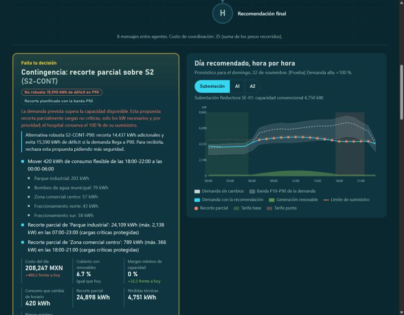
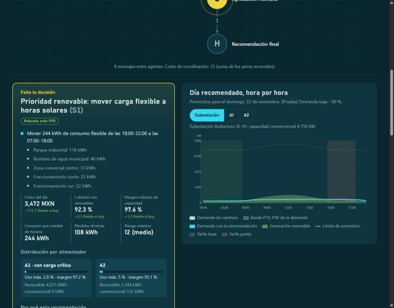
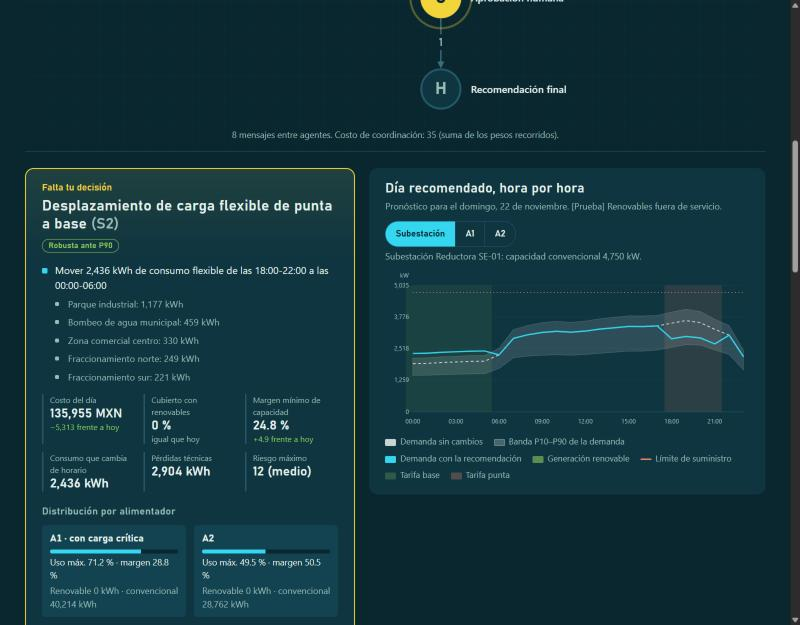
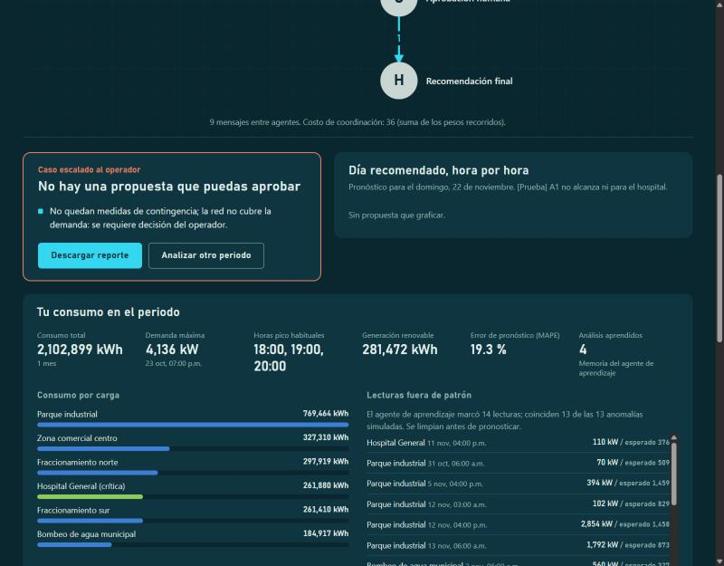

# Informe de pruebas en escenarios adversos — ElectriAgent

Campaña de QA sobre la rama `pruebas-adversas` (base `49c8e49`, `main`). Regla de la campaña:
**probar, no corregir**. No se modificó la lógica de los agentes ni de la distribución; el único
cambio al producto es un gancho de pruebas (`crear_sistema(..., condicion_personalizada=dict)`)
que no se expone en la API, la web ni la app.

Fecha de ejecución: 2026-11-22. Día recomendado fijo en todas las corridas: 2026-11-22 (misma
estacionalidad). Máquina: Windows 11, Intel64 Family 6 Model 186 (12 núcleos lógicos), Python 3.13.14, numpy 2.2.6.

## Cómo reproducir

```powershell
python pruebas_adversas.py --rapido     # solo 1m, < 2 min (≈ 30 s en la máquina de referencia)
python pruebas_adversas.py              # 5 periodos: 1d, 1s, 1m, 6m, 1a (≈ 5 min)
python pruebas_adversas.py --listar     # casos con su semilla
python pruebas_adversas.py --caso F1.hospital-imposible --periodo 1m   # reproduce un caso
python pruebas_adversas.py --relacion M2 --periodo 1a                  # evalúa una relación
python pruebas_adversas.py --servidor-capturas                         # web con condiciones extremas
```

Cada corrida imprime `[caso | periodo | semilla=N] estado propuesta`. Toda la aleatoriedad usa
`numpy.random.default_rng(semilla)`: la semilla del caso alimenta el simulador IoT y los factores
aleatorios (nubes, viento, datos corruptos). Resultados por corrida en
[`resultados.csv`](resultados.csv) (modo completo) y resumen en [`resumen.json`](resumen.json).

Paso 0: HEAD local = `origin/main` = `49c8e49`; `python pruebas.py` pasa sus 32 pruebas. H6: las
ramas remotas `app-movil` y `distribucion-escenarios` ya no existían en GitHub (`git ls-remote`
solo muestra `main`), así que no hubo nada que borrar.

---

## 1. Resumen

| | Modo completo (5 periodos) | Modo rápido (1m) |
|---|---|---|
| Pruebas `unittest` | 37 · `OK (expected failures=10)` · 278 s | 37 · `OK (expected failures=10)` · 30 s |
| Corridas del motor (cada una repetida para I10) | **550** | 115 |
| Evaluaciones de invariantes (sin contar las que no aplican) | **5 458**, cumplen **5 427 (99.43 %)** | 1 145, cumplen 99.48 % |
| Expectativas por familia | 337, cumplen 298 (88.4 %) | 89, cumplen 72 |
| Estados finales | 494 aprobadas, 36 escaladas, 20 excepciones | — |

- **Escenarios**: 59 casos adversos en 7 familias (F1 9, F2 7, F3 13 con 5 semillas de nubes y
  3 de viento, F4 9, F5 5, F6 9, F7 7) y 2 de referencia; 50 corridas por periodo para las 5
  relaciones metamórficas; 20 sesiones concurrentes y 19 entradas adversas contra la API.
- **Las 11 invariantes** se evalúan en cada corrida; las 7 familias y M1–M5 se cubren en los
  5 periodos.
- Las 31 invariantes que fallan y las 39 expectativas que fallan corresponden todas a los
  defectos A1–A10: no hay fallas sin explicar.
- Las 20 «excepciones» son corridas en las que el flujo se rompe: A1 (fallas en B, G o H) y A2
  (medidor sin lecturas).

Defectos: **10** (alta 2, media 7, baja 1). Cada uno tiene una prueba `@unittest.expectedFailure`
con su id en la clase `Defectos` (A7 está en `F7API`); si se corrige, la prueba pasa como
«unexpected success» y la suite lo avisa. La suite termina en verde:
`OK (expected failures=10)`.

## 2. Matriz familia × invariante

`OK`: se cumple en todas las corridas de la familia y periodo; `—`: no aplica (p. ej. I5 sin
contingencia, I2 sin propuesta); `A#`: falla por ese defecto. La última columna es la expectativa
propia de cada familia (estado esperado, detección de datos, costo menor con demanda baja, etc.).

| Familia | I1 | I2 | I3 | I4 | I5 | I6 | I7 | I8 | I9 | I10 | I11 | Esperado |
|---|---|---|---|---|---|---|---|---|---|---|---|---|
| F1 Demanda alta | OK | OK | **A4** | OK | OK | OK | OK | OK | OK | OK | OK | OK |
| F2 Demanda baja | OK | OK | OK | OK | — | OK | **A3** | OK | OK | OK | OK | **A3** |
| F3 Variación renovable | OK | OK | OK | OK | — | OK | OK | OK | OK | OK | OK | OK |
| F4 Disponibilidad renovable | OK | OK | OK | OK | OK | OK | OK | OK | OK | OK | OK | **A5** |
| F5 Combinados extremos | OK | OK | OK | OK | OK | OK | OK | OK | OK | OK | OK | OK |
| F6 Datos IoT | OK | OK | OK | OK | OK | OK | **A3** | OK | **A2** | OK | OK | **A2, A6, A8, A9** |
| F7 Agentes y servidor | OK | OK | OK | OK | — | OK | OK | OK | **A1** | OK | OK | **A1, A7** |
| M1–M5 (corridas) | OK | OK | OK | OK | OK | OK | OK | OK | OK | OK | OK | OK |
| REF (referencia) | OK | OK | OK | OK | — | OK | OK | OK | OK | OK | OK | **A10** |

Relaciones metamórficas en los 5 periodos:

| Relación | 1d | 1s | 1m | 6m | 1a | Evidencia (1m) |
|---|---|---|---|---|---|---|
| M1 más demanda → déficit y recorte no bajan | OK | OK | OK | OK | OK | déficit S0 0 → 0 → 5 400 → 25 320 → 56 001 kWh (×1 … ×2.5) |
| M2 más renovable → convencional y costo no suben | OK | OK | OK | OK | OK | convencional 68 975 → 50 614 kWh; costo total con déficit: hallazgo 4.2 |
| M3 menos capacidad → déficit no baja | OK | OK | OK | OK | OK | SE ×1 … ×0.4: 0 → 2 276 → 10 075 → 21 561 → 37 177 kWh |
| M4 quitar renovable → margen no mejora | OK | OK | OK | OK | OK | A1 sin eólica: 36.5 % → 28.8 % |
| M5 escala ×0.5 y ×2 → mismo % de recorte (±1) | OK | OK | OK | OK | OK | 4.04 % en los tres factores (diferencia 0.00) |

## 3. Defectos

| Id | Severidad | Título | Familia / invariante |
|---|---|---|---|
| A1 | alta | Una falla en B, G o H tumba al supervisor (`KeyError`) | F7 · I9 |
| A8 | alta | Con historial corto, lecturas negativas dan pronóstico negativo y P90 < P10 | F6 · esperado |
| A2 | media | Un medidor sin lecturas hace fallar a B y, por A1, rompe el flujo | F6 · I9 |
| A3 | media | Demanda nula: división entre cero en E; se escala con un diagnóstico falso | F2, F6 · I7 |
| A4 | media | Si la red no alcanza ni para el hospital, el escalamiento no lo dice | F1 · I3 |
| A5 | media | La cobertura de bandas (ISO/IEC 5338) ignora las renovables | F4 · esperado |
| A6 | media | Con 1 día de historial la banda P10-P90 es más estrecha que con 1 mes | F6 · esperado |
| A9 | media | No hay detector de sensor congelado | F6 · esperado |
| A10 | media | El pronóstico ignora el tipo de día: en fin de semana el MAPE sube a ~19 % | REF · esperado |
| A7 | baja | La API devuelve 500 ante tipos JSON inesperados o `Content-Length` inválido | F7 · API |

### A1 · alta · Una falla en B, G o H tumba al supervisor

- **Escenario**: `F7.falla-B`, `F7.falla-G`, `F7.falla-H` (el agente falla una sola vez), semilla 7,
  los 5 periodos. `python pruebas_adversas.py --caso F7.falla-B --periodo 1m`.
- **Esperado**: el canal de excepciones lleva el `FAILURE` a C, que reintenta una vez o escala
  ("Falla persistente en X"); el flujo termina (I9).
- **Obtenido**: `KeyError: 'B'` (o `'G'`, `'H'`) sale de `BusCoordinacion.ejecutar()`. Como C es el
  supervisor, su excepción no se canaliza: no hay reporte, la bitácora queda incompleta y en la
  API sería un 500.
- **Regla afectada**: mecanismo 5 de `coordinacion.py` (canal de excepciones), I9; ISO/IEC 5338
  (registro del ciclo de vida) e ISO/IEC 23894 (tratamiento del riesgo operativo).
- **Causa probable**: [agentes.py:777](../../agentes.py#L777), `AgenteMeta._manejar_falla` reenvía
  `self.ultima_solicitud[destino]`, pero ese diccionario solo tiene D y E (las únicas tareas que C
  pide con `_solicitar`). B recibe su solicitud de A, y G y H reciben `PROPOSE`/`INFORM` con
  `enviar`. Falta escalar cuando no hay solicitud que repetir.

### A8 · alta · Historial corto + lecturas negativas → pronóstico negativo y P90 < P10

- **Escenario**: `F6.negativas` (5 % de lecturas con signo invertido), semilla 7, periodos 1d y 1s.
  `python pruebas_adversas.py --caso F6.negativas --periodo 1d`.
- **Esperado**: D descarta o marca las lecturas físicamente imposibles (consumo < 0) y el pronóstico
  queda ≥ 0 con P10 ≤ P50 ≤ P90.
- **Obtenido**: D marca el 100 % (1d) y el 98 % (1s) de las lecturas alteradas, pero las «limpia»
  con una referencia negativa. En 1d, *Fraccionamiento norte* a las 00:00 tiene lecturas
  −297, 303, −267: la mediana local es −267. D reemplaza la lectura válida de las 01:00 (303 kW)
  por −4.9 kW, el pronóstico queda en −267 kW y la banda queda con P90 = −294 < P10 = 0. En 1s,
  *Hospital General* (carga crítica) queda con pronóstico de −128 kW. Nada alerta al operador y E
  planifica con menos demanda de la real.
- **Regla afectada**: Regla 1 (suministro: se subestima la demanda), I7 (valores físicamente
  imposibles); ISO/IEC 23894 (calidad de datos como fuente de riesgo).
- **Causa probable**: [agentes.py:87-88](../../agentes.py#L87) `AgenteAprendizaje._referencia`
  con `dias < 3` usa la mediana de ±2 horas, que puede ser negativa;
  [agentes.py:181](../../agentes.py#L181) divide entre `max(ref, 1e-6)` (con referencia negativa,
  toda lectura normal parece anómala); [agentes.py:191](../../agentes.py#L191) copia la referencia
  negativa. `_banda` ([agentes.py:147-149](../../agentes.py#L147)) recorta P10 en 0, pero no P90.
  Falta una validación física (consumo ≥ 0) antes de la detección estadística.

### A2 · media · Un medidor sin ninguna lectura válida rompe el flujo

- **Escenario**: `F6.sensor-fuera` (el medidor de *Zona comercial centro* entrega 100 % NaN),
  semilla 7, los 5 periodos. `python pruebas_adversas.py --caso F6.sensor-fuera --periodo 1m`.
- **Esperado**: B o D marcan el sensor fuera de servicio, estiman su carga (perfil típico) y avisan;
  el flujo termina.
- **Obtenido**: `np.interp` falla con «array of sample points is empty» y B reporta `FAILURE`.
  Después, A1 convierte esa falla en `KeyError: 'B'` y el flujo se rompe.
- **Regla afectada**: I9; ISO/IEC 5338 (monitoreo de datos de entrada).
- **Causa probable**: [agentes.py:64](../../agentes.py#L64), `CapturaIoT.procesar` interpola sin
  comprobar que haya al menos una lectura válida.

### A3 · media · Demanda nula: división entre cero y diagnóstico falso

- **Escenario**: `F2.cero-total` (todas las cargas a 0), los 5 periodos; y
  `F6.apagon-ultimo-dia` en 1d (un día entero de lecturas en 0 es todo el historial).
  `python pruebas_adversas.py --caso F2.cero-total --periodo 1m`.
- **Esperado**: con demanda cero, S0 sin acciones (nada que recortar ni desplazar), métricas
  finitas (I7: «con demanda cero no puede haber divisiones entre cero»).
- **Obtenido**: `ZeroDivisionError: float division by zero` en E. C reintenta, E vuelve a fallar
  y se escala con «Falla persistente en E». El operador recibe un diagnóstico de falla interna
  en vez de «no hay demanda».
- **Regla afectada**: I7; ISO/IEC 5338 (trazabilidad: el motivo registrado es incorrecto).
- **Causa probable**: [agentes.py:382](../../agentes.py#L382),
  `AgenteDeliberativo._metricas` calcula `desplazado / demanda_original_kwh` sin protección. Las
  demás razones (`renovable_pct`, márgenes) sí usan `max(..., 1e-6)`.

### A4 · media · Hospital sin cobertura: el escalamiento no lo dice

- **Escenario**: `F1.hospital-imposible` (hospital ×3 y A1 al 20 %), semilla 7, los 5 periodos.
  La red deja sin servir entre 7 351 kWh (1d) y 8 291 kWh (1m) de **carga crítica** aunque se
  recorte todo lo demás. `python pruebas_adversas.py --caso F1.hospital-imposible --periodo 1m`.
- **Esperado** (I3): escalar al operador y decir explícitamente que la red no alcanza para las
  cargas críticas.
- **Obtenido**: escala correctamente (no propone), pero con el motivo genérico «No quedan medidas
  de contingencia; la red no cubre la demanda». El reporte no trae el impacto ISO/IEC 42005 sobre
  el hospital porque no hay recomendación (ver captura 4).
- **Regla afectada**: Regla 1 (prioridad de las cargas críticas), I3; ISO/IEC 42005 (impacto en el
  grupo de interés más sensible).
- **Causa probable**: [agentes.py:789-792](../../agentes.py#L789), `AgenteMeta._decidir` escala
  con `MOTIVO_SIN_MEDIDAS` sin consultar `no_servido_por_tipo_kwh["critica"]` de los escenarios de
  contingencia.

### A5 · media · La cobertura de bandas ignora las renovables

- **Escenario**: `F4.cobertura-renovable` (la generación del último día del historial cae al 30 %,
  por debajo de P10), semilla 7. Falla en 1m, 6m y 1a; en 1d no hay validación (< 3 días) y en 1s
  la alerta salta por casualidad (la cobertura de la demanda ya era baja, 36.8 %).
  `python pruebas_adversas.py --caso F4.cobertura-renovable --periodo 1m`.
- **Esperado**: la validación fuera de muestra (ISO/IEC 5338) detecta que la renovable real quedó
  fuera de su banda.
- **Obtenido**: cobertura 93.1 % (1m), 84.0 % (6m), 81.2 % (1a), sin alerta: las 144 lecturas
  validadas son 6 cargas × 24 h, ninguna renovable. El impacto se midió en `F4.optimista-trafo55`:
  si la renovable real queda en 0.5 × P10, el plan aprobado deja **4 428 kWh sin servir no
  previstos** (1m; entre 844 y 4 589 kWh según el periodo).
- **Regla afectada**: ISO/IEC 5338 (monitoreo del desempeño), ISO/IEC 23894 (riesgo de error de
  pronóstico de renovables).
- **Causa probable**: [agentes.py:152](../../agentes.py#L152), `AgenteAprendizaje._cobertura`
  recorre solo `limpias` (consumo). Las bandas de `_residuales_renovable` nunca se validan.

### A6 · media · Con 1 día la banda P10-P90 es más estrecha que con 1 mes

- **Escenario**: `F6.historial-1d` (operación normal, periodo 1d).
  `python pruebas_adversas.py --caso F6.historial-1d --periodo 1d`.
- **Esperado**: con casi nada de historial la incertidumbre es mayor: banda al menos tan ancha como
  con 1 mes. MAPE y cobertura «sin datos» (✔ se cumple).
- **Obtenido**: ancho máximo de la banda de demanda **10.1 % con 1 día contra 41.7 % con 1 mes**.
  Como con menos de 3 días no hay validación de cobertura, nada lo advierte, y la robustez P90 de
  E resulta optimista en 1d.
- **Regla afectada**: ISO/IEC 23894 (estimación de la incertidumbre), ISO/IEC 5338.
- **Causa probable**: [agentes.py:113-126](../../agentes.py#L113),
  `AgenteAprendizaje._residuales` con un día mide solo la desviación frente a la mediana de
  ±2 horas (ruido intradía) y omite la variación entre días. Falta un piso de incertidumbre
  para historiales cortos.

### A9 · media · No hay detector de sensor congelado

- **Escenario**: `F6.congelado` (el medidor comercial repite el mismo valor 7 días), semilla 7.
  `python pruebas_adversas.py --caso F6.congelado --periodo 1s`.
- **Esperado**: D marca el sensor (umbral común de F6: ≥ 90 % de lecturas alteradas marcadas,
  igual que negativas y picos).
- **Obtenido**: 0 % en 1d y 1s (todo el historial está congelado), 86 % en 1m y 92 % en 6m y 1a.
  Las marcas aparecen solo porque el valor congelado se aleja de la mediana horaria, no por una
  detección de valor constante.
- **Regla afectada**: ISO/IEC 5338 (calidad de los datos de entrada).
- **Causa probable**: [agentes.py:178-192](../../agentes.py#L178), `AgenteAprendizaje.procesar`
  solo detecta desviaciones (z robusto). Falta una regla de varianza nula o de repetición.

### A10 · media · El pronóstico ignora el tipo de día (laboral / fin de semana)

- **Escenario**: operación normal (`REF.normal`), semilla 7, día recomendado domingo 2026-11-22;
  la validación del MAPE se hace sobre el último día del historial (sábado 21). Comparación:
  `REF.normal-jueves` (recomienda el jueves 19; la validación cae en miércoles).
  `python pruebas_adversas.py Defectos.test_A10_pronostico_ignora_fin_de_semana`.
- **Esperado**: el MAPE de validación queda bajo el umbral de reentrenamiento (15 %) en operación
  normal, como entre semana.
- **Obtenido**: MAPE de validación de **20.31 % (1s), 19.25 % (1m), 19.13 % (6m) y 19.08 % (1a)** validando sobre sábado, contra **6.41 %, 5.88 %, 6.19 % y 5.94 %** validando sobre miércoles. La alerta de deriva («Re-entrenar / revisar el modelo») queda encendida en
  operación normal todo fin de semana y lunes. El riesgo «Error de pronóstico» (prob. 4 × impacto 3
  = 12) se vuelve el máximo de casi todas las propuestas. Además, para un sábado o domingo el
  pronóstico promedia sobre todo días laborales: sobreestima la demanda comercial e industrial
  (en el simulador el fin de semana vale 0.70 y 0.60 de un día laboral) y los recortes de
  contingencia salen mayores de lo necesario.
- **Regla afectada**: Regla 1 y política de recorte mínimo (el recorte se calcula sobre una
  demanda inflada); ISO/IEC 5338 (alerta de deriva sin deriva real); ISO/IEC 23894.
- **Causa probable**: [agentes.py:101-110](../../agentes.py#L101),
  `AgenteAprendizaje._pronostico` usa un promedio ponderado de los últimos 7 días sin distinguir
  el tipo de día. `_referencia`, la detección de anomalías de D, sí lo distingue
  ([agentes.py:89-97](../../agentes.py#L89)).
- **Nota para leer la campaña**: todas las corridas recomiendan el mismo domingo, así que las
  demandas planificadas de F1–F7 tienen este sesgo conservador. Las relaciones y las invariantes
  no dependen de él.

### A7 · baja · La API responde 500 ante entradas mal tipadas

- **Escenario**: `F7API.test_A7_api_500_con_tipos_inesperados`.
- **Esperado**: 4xx con un mensaje claro, nunca 500.
- **Obtenido**: `{"periodo": ["1m"]}` → 500 «unhashable type: 'list'»;
  `{"condicion": {"id": "normal"}}` → 500; `Content-Length: abc` → 500;
  `Content-Length: -5` → 500. Además, el 500 expone el mensaje interno de Python.
- **Regla afectada**: contrato de la API (los errores del cliente deben ser 4xx).
- **Causa probable**: [servidor.py:242-245](../../servidor.py#L242), `crear_sesion` compara con
  `in` sin validar el tipo; [servidor.py:366](../../servidor.py#L366), `Manejador._leer_json`
  convierte `Content-Length` con `int()` sin capturar el error ni rechazar negativos.

Las entradas adversas del enunciado (crecimiento fuera de rango, alimentador inválido, motivo de
501 caracteres, JSON malformado, cuerpo de 11 KB) responden 400 o 413 con un mensaje claro: ✔.

## 4. Hallazgos de comportamiento (no son defectos)

**4.1 Renovable desperdiciada con demanda baja y límite de inyección inactivo.** Con demanda −90 %
se desperdician **2 574 a 4 518 kWh/día** de renovable (1m: 2 742 kWh, con un 92.3 % de la
demanda cubierta con renovables). Con renovables al 150 % y demanda −90 % se desperdician
**6 546 a 9 510 kWh**. Con −60 % no se desperdicia nada. La Regla 2 se cumple (I6 OK en todas
las corridas): solo se desperdicia cuando el otro alimentador ya no necesita más. El límite de
inyección de 800 kW **nunca llega a actuar**: el modelo no exporta aguas arriba de la subestación,
así que el excedente solo puede ir al otro alimentador y lo acota su necesidad (≈ 200 kW con
−90 %). Además, el límite se aplica por alimentador
([distribucion.py:97](../../distribucion.py#L97)), no al agregado. Con dos alimentadores da lo
mismo, pero no con más.

**4.2 M2 literal en déficit.** Más renovable siempre reduce la energía convencional y su costo
(✔ en los 5 periodos). Pero con demanda ×2 el **costo total** de S0 sube: en 1m pasa de 206 672 a
208 047 MXN entre renovable ×0 y ×1.5, porque se sirve más demanda (el déficit baja de 33 344 a
21 477 kWh) y cada kWh renovable cuesta 0.30 MXN de O&M. No es un defecto del motor: la relación
solo vale a igual energía servida. La prueba exige la convencional, el costo convencional y el
costo total cuando no hay déficit; el costo total literal queda en las notas de la fila M2 del CSV.

**4.3 Contingencia natural con 3 rechazos.** Escala, como se esperaba, pero tras el **primer**
rechazo (costo 60, de 1s a 1a): el rechazo automático pide «menos invasiva» y no hay plan con menos
recorte. Si el operador pide más seguridad, escala tras el segundo rechazo (costo 84). Solo en 1d
llega al máximo de 3 rechazos (costo 95). Es coherente con la política de recorte (H2), pero el
tope de 3 rechazos casi nunca se alcanza en contingencia.

**4.4 Pronóstico optimista.** Con la renovable real en 0.5 × P10 en operación normal, ola de calor
o +30 % de demanda no queda déficit no previsto: el margen de capacidad absorbe los ≈ 5 400 kWh de
renovable que faltan. Con el transformador al 55 % quedan **844 a 4 589 kWh sin servir**. El plan
robusto (`*-CONT-P90`) solo cubre hasta P10 de renovable.

**4.5 Demanda alta.** Hasta +30 %, con el pico concentrado (19:00–22:00) y con demanda alta solo en
A2, el desplazamiento elimina el déficit sin recortar (F1.alta-A2: déficit de S0 2 201 kWh → S3 sin
recorte; F1.pico-19a22: 1 545 kWh → S2). Desde +60 % se recorta, y el recorte propuesto es menor
que el déficit de S0 porque primero se desplaza carga (1m, +60 %: 1 979 kWh de recorte contra
5 400 kWh de déficit). Con el hospital +50 % (sin otras fallas) no hace falta recortar. En los
combinados extremos (+60 %, renovables fuera, transformador al 55 %) se recortan 35 416 a
50 887 kWh sin tocar el hospital (I3 OK).

**4.6 Datos IoT.** Los NaN al 10 % y al 40 % se interpolan todos (1a: 28 157 inyectados y 28 210
interpolados, contando las pérdidas propias del simulador). Los picos ×50 se marcan al 100 % en los
5 periodos y las lecturas negativas desde 1m (en 1d y 1s, ver A8). El reloj desfasado una hora no se
detecta, lo cual es esperable sin correlación cruzada, y no altera el flujo. Un día de apagón en el
historial se limpia como anomalía desde 1s (144 de 144 lecturas). El flujo nunca se rompe por datos,
salvo con un medidor sin ninguna lectura (A2).

**4.7 Aprendizaje y determinismo.** I10 se cumple en todas las corridas con una memoria de
aprendizaje nueva. Con memoria compartida, como en el servidor, D mezcla el 25 % del perfil de la
ejecución anterior, así que la misma semilla da resultados distintos según el orden de las sesiones.
Es aprendizaje, no un defecto, pero hay que tenerlo en cuenta al reproducir un caso de la API. Con 20
sesiones concurrentes la memoria termina con JSON válido y `ejecuciones = 20` (sin escrituras
perdidas).

**4.8 Riesgo dominante.** El riesgo máximo de casi todas las propuestas es 12 (medio) por «Error de
pronóstico» (probabilidad 4), consecuencia de A10. En 1d no hay MAPE y F supone el 20 %, con el
mismo resultado. Por eso el riesgo máximo apenas distingue escenarios: en la captura 2 (demanda
−90 %) y la 3 (renovables fuera) vale 12, igual que en operación normal.

**4.9 Cosmético.** Con demanda −60 % en 1d, la justificación dice «(-0 kWh renovables sin
aprovechar)»: un −0.0 que se redondea con signo. I8 lo acepta porque cae dentro de la tolerancia.
Los márgenes ya usan `+ 0.0` para evitarlo, pero esta métrica no.

**4.10 Costo de coordinación con fallas.** Se confirma 36 sin rechazos y +24 por rechazo. Un
`FAILURE` que viaja por un enlace del grafo cobra su peso (D→C y F→C pesan 2), así que una falla de
D cuesta +10 (2 + 8 del reintento) y una de F +13 (2 + 6 + 5): D y luego F suma 59. Fallas
persistentes: D 33, E 35, F 49, todas escaladas con «Falla persistente en X».

**4.11 Márgenes por alimentador (M4).** Quitar la solar de A2 nunca cambia el margen mínimo de A2,
porque ese mínimo ocurre en el pico vespertino, sin sol. Quitar la eólica de A1 baja su margen entre
4 y 8 puntos, y con demanda ×1.6 deja A1 en sobrecarga en S0 (margen −6 % → −14 % en 1m).

## 5. Rendimiento

Máquina: Windows 11 (10.0.26200), Intel64 Family 6 Model 186 (12 núcleos lógicos), Python 3.13.14,
numpy 2.2.6. Tiempo de un análisis completo (A→H, modo automático, 4 corridas por periodo: 3 en
normal y 1 con +60 %):

| Periodo | Mediana | Máximo | Umbral |
|---|---|---|---|
| 1d | 0.041 s | 0.046 s | |
| 1s | 0.046 s | 0.056 s | |
| 1m | 0.109 s | 0.239 s | |
| 6m | 0.376 s | 0.389 s | |
| 1a | 0.618 s | 0.674 s | < 10 s ✔ |

API con 20 sesiones simultáneas (`ThreadPoolExecutor`, 20 hilos, condiciones y periodos
distintos, de 1d a 1a): **p50 2.79 s, p95 4.96 s, máximo 5.53 s** (umbral p95 < 15 s ✔), sin
errores 500, sesiones aisladas (cada una solo con mensajes de su conversación) y memoria de
aprendizaje con JSON válido y 20 ejecuciones. El servidor serializa el motor con `_motor_lock`, así
que la latencia crece de forma lineal con la cola: el p95 se acerca a N × (tiempo de un análisis).
Con 20 sesiones de 1a serían ≈ 13 s, cerca del umbral.

## 6. Recomendaciones priorizadas (para el prompt de corrección)

1. **A1**: en `AgenteMeta._manejar_falla`, si `destino` no está en `ultima_solicitud`, escalar
   («Falla en B/G/H») en vez de lanzar `KeyError`. Prueba: `Defectos.test_A1_*`.
2. **A8 + A2 + A9** (calidad de datos en B y D): marcar como inválidas las lecturas negativas
   antes de la detección estadística (tratarlas como faltantes); impedir referencias negativas;
   recortar P90 ≥ P10 ≥ 0; marcar un sensor sin lecturas o con varianza nula durante N horas como
   «fuera de servicio» y estimar su carga con el perfil típico, con una alerta en la trazabilidad.
3. **A4**: si un escenario de contingencia deja `no_servido_por_tipo_kwh["critica"] > 0`, escalar
   con un motivo explícito («la red no alcanza para las cargas críticas: X kWh del hospital») e
   incluir el impacto ISO/IEC 42005 en el reporte escalado.
4. **A5**: extender `_cobertura` a las fuentes renovables (energía diaria contra su banda) y
   reportar coberturas separadas de demanda y renovable.
5. **A10**: pronosticar por tipo de día (mismo día de la semana o laboral / fin de semana, como ya
   hace `_referencia`) y validar el MAPE sobre un día del mismo tipo que el recomendado.
6. **A3**: proteger `desplazado_pct` (y cualquier razón nueva) con `max(demanda, 1e-6)`. Con demanda
   cero, proponer S0 sin acciones.
7. **A6**: imponer un ancho mínimo de banda con historial corto (p. ej. la banda por omisión de la
   renovable o un piso del ±20 %) y advertir «incertidumbre no validada» con menos de 3 días.
8. **A7**: validar tipos (`isinstance(..., str)`) antes de `in`, y parsear `Content-Length` con
   `try` y rechazar negativos con 400. No devolver el texto de la excepción en el 500.
9. Decisiones de diseño pendientes (hallazgos 4.1 y 4.2): si el excedente renovable puede
   exportarse aguas arriba (hoy `limite_inyeccion_kw` nunca actúa) y cómo comparar costos cuando
   cambia la energía servida.

Cada corrección debe convertir su prueba `expectedFailure` en un «unexpected success». Entonces
se quita el decorador y el par del diccionario `DEFECTOS` de `pruebas_adversas.py`.

## 7. Capturas en escenarios extremos

Tomadas con `python pruebas_adversas.py --servidor-capturas`, que agrega condiciones de prueba
(«[Prueba] …») al catálogo **solo en ese proceso**. La web y la API son las de producción.

**1. Demanda alta (+100 %).** Contingencia S2-CONT: recorte parcial de 24 898 kWh (parque
industrial 24 109 kWh y zona comercial 789 kWh) con el hospital al 100 %. La alternativa robusta
S2-CONT-P90 recortaría 14 437 kWh más para evitar 15 590 kWh de déficit en P90. Margen mínimo 0 %.



**2. Demanda baja (−90 %).** S1 (prioridad renovable): las renovables cubren el 92.3 % y el costo
baja a 3 472 MXN; se mueven 244 kWh a horas solares y el margen es del 97.6 %. Robusta ante P90.



**3. Renovables fuera de servicio.** S2 (desplazamiento de punta a base): el 0 % de la demanda se
cubre con renovables, costo 135 955 MXN y margen mínimo del 24.8 %, sin recorte. Robusta ante P90.



**4. A1 no alcanza ni para el hospital (evidencia de A4).** El caso se escala y no se propone ningún
plan (correcto), pero el motivo es el genérico «No quedan medidas de contingencia; la red no cubre
la demanda» y no menciona la carga crítica.



---

## Anexo A · Oráculos y decisiones de medición

| Inv. | Cómo se mide | Alcance |
|---|---|---|
| I1 | `demanda = renovable_usada + convencional + recorte + no_servido` por hora y alimentador, ±0.1 kW | todos los escenarios simulados, bandas P50 y P90 |
| I2 | cabecera ≤ capacidad del alimentador; trafo BT ≤ su capacidad; requerido en la subestación ≤ su capacidad (+0.1 kW) | cada propuesta que C envía a G (P50) |
| I3 | crítica sin recorte ni energía sin servir en cada propuesta. Oráculo independiente: se asigna solo la carga crítica; si aun así queda sin servir, el flujo debe escalar y el motivo debe mencionar «crítica» | propuestas + escalamiento |
| I4 | `deficit_kwh == 0` en P50 | cada propuesta C→G (incluidas las que siguen a un rechazo), capturadas con un espía sobre G |
| I5 | 1.ª propuesta de contingencia ≤ déficit central × 1.05 + 0.1; `recorte_adicional_robustez_kwh = recorte(CONT-P90) − recorte(CONT)` en ambos escenarios y en la decisión | escenarios de contingencia |
| I6 | usada ≤ disponible; desperdiciada ≥ 0; inyección = disponible − uso local − desperdicio, ≤ `limite_inyeccion_kw`. Regla 2: no puede haber desperdicio en el alimentador k a la hora h si k compra convencional, o si otro alimentador la compra y la inyección de k no llegó a su tope | todos los escenarios, P50 y P90 |
| I7 | todo número de las métricas P50 y P90 finito y ≥ 0 (los márgenes pueden ser negativos: sobrecarga real); sin `ZeroDivisionError` ni avisos de numpy; vista de la API y reporte con `json.dumps(allow_nan=False)` | todas las corridas |
| I8 | cada número citado en la justificación se compara con su métrica: ±0.1 si el texto muestra decimales y ±0.5 si redondea a entero (`{:,.0f}`). Afirmaciones: «sin déficit», «sin déficit en P90», «ninguna estrategia viable es robusta», «críticas al 100 %», categoría de riesgo | cada propuesta |
| I9 | estado final aprobada o escalada, < 40 mensajes, todos los enlaces del grafo (o `FAILURE`→C), inicio A→B, fin G→H, costo = suma de pesos. Sin fallas: costo = 36 + 24·rechazos − 13 si el último rechazo agota el máximo (C escala sin volver a deliberar). Un `FAILURE` por un enlace existente cobra su peso (D→C y F→C = 2) | todas las corridas |
| I10 | segunda corrida con la misma semilla y una memoria de aprendizaje nueva: huella JSON idéntica (estado, propuestas, métricas, justificación, recorrido, costo) | todas las corridas |
| I11 | todo escenario con déficit P90 > 0 tiene «Insuficiencia de capacidad» con probabilidad ≥ 4 | todas las evaluaciones de F |

**Gancho de pruebas.** `condiciones.validar_personalizada` acepta factores de demanda por tipo de
carga y de renovables por fuente, escalares o de 24 valores horarios. Límites: demanda 0 … 3
(3 = el tope de `crecimiento_pct`, 200 %; el 0 se admite para probar demanda nula); renovable
0 … 2; capacidad y `factor_alimentador` (0, 1]; `crecimiento_pct` −50 … 200 como el catálogo. El
agente E lo usa en lugar de `resolver()` cuando existe. `GanchoDePruebas` verifica la validación,
que una condición vacía da el mismo resultado que `normal` y que la palabra no aparece en
`servidor.py`, `main.py`, `web/app.js` ni `mobile/src`. Además, la API ignora la clave si alguien
la envía.

**Datos IoT adversos.** Se alteran las lecturas que entrega el simulador, antes de B, envolviendo
`SimuladorIoT.capturar` en la prueba. Las fallas persistentes de agentes se simulan sustituyendo
su `procesar` en la prueba. El motor no tiene código de prueba.

## Anexo: fallas añadidas por la evaluación de resultados (B1–B3)

La campaña de evaluación de resultados (`python evaluar.py`, informe en
[`docs/evaluacion/INFORME.md`](../evaluacion/INFORME.md)) registró tres fallas nuevas. Cada una tiene su
entrada en `DEFECTOS` y una prueba `@unittest.expectedFailure` en la clase `DefectosEvaluacion` de
`pruebas_adversas.py`, así que la suite sigue en verde con `OK (expected failures=13)`.

| Id | Severidad | Falla | Prueba |
|---|---|---|---|
| B1 | alta | En día laboral el pronóstico subestima la demanda ~5 % (la ventana de 7 días arrastra el fin de semana) y nada mide el sesgo: el plan aprobado «sin déficit» deja energía no suministrada no prevista | `DefectosEvaluacion.test_B1_sesgo_del_pronostico_en_dia_laboral` |
| B2 | media | Al rechazar el recorte mínimo pidiendo recortar menos, el escalamiento dice «No quedan medidas de contingencia» sin decir que el plan rechazado ya era el mínimo ni cuánta energía quedará sin servir sin aviso | `DefectosEvaluacion.test_B2_escalamiento_tras_rechazar_el_recorte_minimo` |
| B3 | baja | En contingencia el impacto ISO/IEC 42005 al operador compara costos sin igualar la energía servida: marca «negativo» aunque el costo por kWh servido baja | `DefectosEvaluacion.test_B3_impacto_al_operador_a_igual_energia_servida` |
